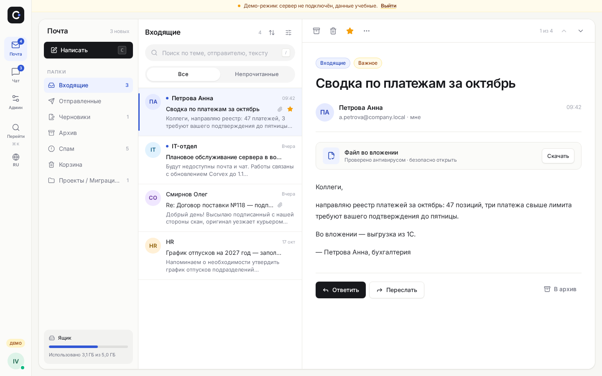
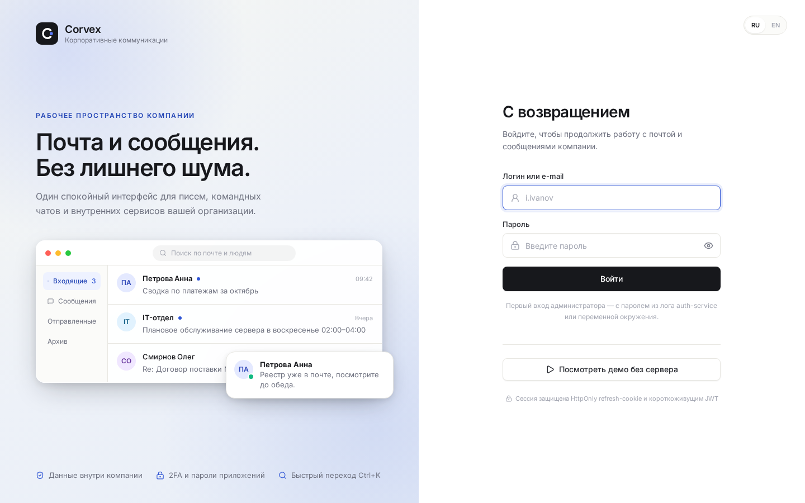
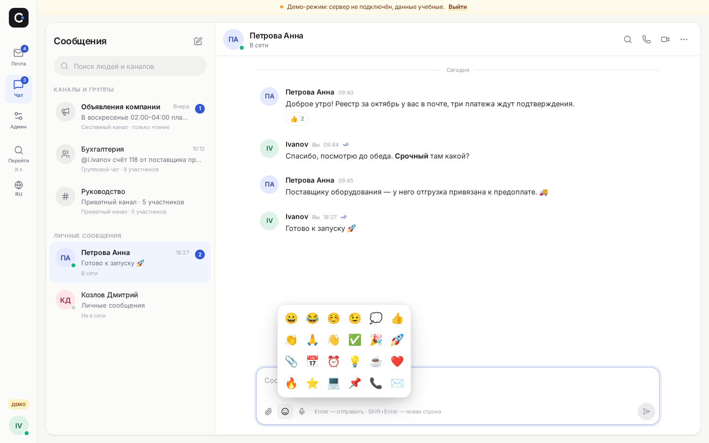
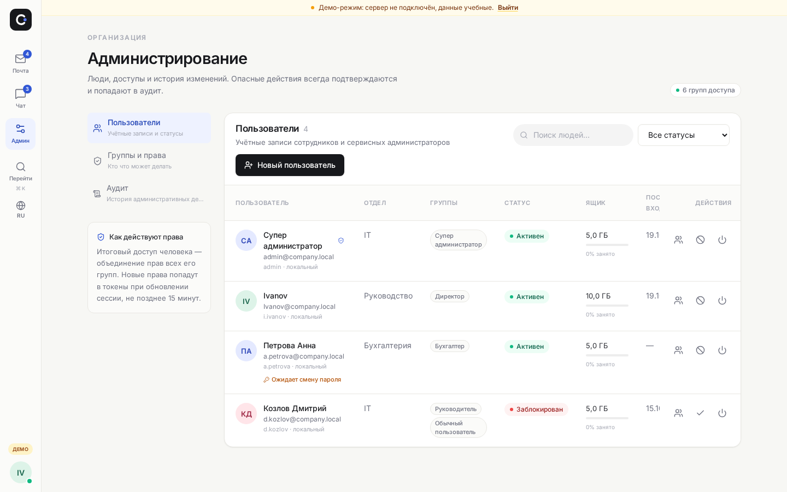
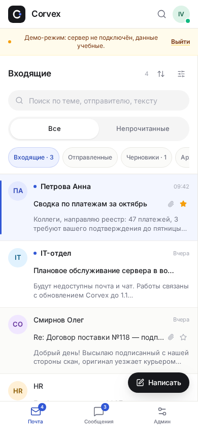

<div align="center">


# Corvex

**Corporate mail, chat, calendar and files that stay on your server.**

<sub>Free &amp; open source (Apache-2.0). 12 Java services and one React frontend in a single
Docker Compose stack.</sub>

[English](#what-it-is) · [Русский](README.md) · [Status](docs/STATUS.md) · [Install](docs/INSTALL.en.md) · [Requirements](docs/SERVER-REQUIREMENTS.md) · [Docs](docs/README.md) · [Contributing](CONTRIBUTING.md)

[](LICENSE)
[](docs/STATUS.md)
[](https://t.me/Artem_Dobrokvashin)

[](docs/screenshots/mail-ru.png)

<sub>Real screenshot of the built frontend with demo data. It shows rendering, not a verified
server: actual test results are in [docs/STATUS.md](docs/STATUS.md).</sub>

</div>

## What it is

Corvex is a self-hosted communication platform for an organisation: its own mail server
(SMTP, IMAP, POP3), webmail, real-time chat, calendar with email reminders, a personal file
drive and an admin panel with granular permissions. Everything runs on the company's own
server from a single `docker-compose`; data, users and audit logs stay inside, and nothing
is sent to an external SaaS.

Who it is for: organisations that want to own their correspondence; teams whose fleet still
includes Windows 7 and Chrome 109; those who do not want to pay per user or accept closed
source.

The project is led by one developer, **Artem Dobrokvashin**. Code, architecture and
documentation are developed in the open. Contributions: [`CONTRIBUTING.md`](CONTRIBUTING.md).

> [!CAUTION]
> **Corvex is not production-ready yet.** Install, login, admin, mail, chat, calendar and the
> drive are written and build, and some scenarios have been verified on a test stand, but the
> full end-to-end mail run, mail-client acceptance and backup restore are still open. This is
> a development and acceptance stand, not a replacement for working mail: do not point
> production MX records at it and do not migrate live mailboxes. See
> [`docs/STATUS.md`](docs/STATUS.md) for exactly what has been verified.

## Features

- **Mail.** Durable SMTP intake, SpamAssassin → ClamAV → storage pipeline, Maildir with
  SHA-256 attachment deduplication, DKIM, outbound queue with retries and DSN, submission 587
  with AUTH and STARTTLS, IMAP and POP3 via Apache James.
- **Webmail.** Folders, message list and reading, attachments, sending, drafts, signatures,
  search, bulk actions and forwarding with attachments, HTML mail with external images
  blocked until explicitly allowed, RU/EN.
- **External mailboxes.** Existing Mail.ru, Yandex, Gmail, Outlook or custom accounts connect
  over IMAP/POP3: new-mail polling, archive import, deduplication, send-as.
- **Chat.** Rooms and direct messages, history in PostgreSQL, STOMP over RabbitMQ, reactions,
  pins, read state, mentions, search, files scanned by antivirus.
- **Calendar.** Events with IANA time zones, recurrence, attendees, server-side email
  reminders that arrive with the browser closed and survive a restart.
- **Files.** Personal drive: folders, search, trash, move, and Google Drive-style links —
  private by default, shared explicitly, revoked instantly.
- **Administration.** Users, quotas, 6 built-in and custom groups, 25 atomic permissions
  (group permissions add up), audit log, health, analytics, protection of the last
  super-admin.
- **Security.** Argon2id, lockout, 15-minute RS256 JWT, rotating refresh sessions in
  HttpOnly `SameSite=Strict` cookies, TOTP, app passwords, internal APIs behind a shared
  secret with fail-closed behaviour.
- **Operations.** Prometheus, Grafana, Loki, Alertmanager and an independent `alert-relay`
  for external SMTP/Telegram/MAX when internal mail is down; backup, restore and acceptance
  scripts.
- **Legacy fleet.** A modern bundle for current browsers and a legacy bundle for Chrome 109,
  responsive from 320 px, fully RU/EN.

## Requirements

One server (physical or VM): **4–6 vCPU, 16 GB RAM, 200 GB SSD** (100 GB system + 100 GB
data) and a separate 100–200 GB medium for backups — sized for 50 mailboxes. You need a
public IP, port 25 in both directions and the ability to set a PTR record. No paid licences;
the Let's Encrypt certificate is free.

Full requirements — network, ports, DNS, certificate, access, and the formula for other
mailbox counts: [`docs/SERVER-REQUIREMENTS.md`](docs/SERVER-REQUIREMENTS.md).

## Quick start

**Look at the interface without a server** — only Node.js is required
(`^22.22.2 || ^24.15.0 || >=26`):

```bash
git clone https://github.com/ArtemDobrokvashin/Corvex-.git
cd Corvex-/frontend
npm ci
npm run dev
```

Open `http://localhost:5173` and click “Посмотреть демо без сервера”. Mail, chat and admin
open on demo data with a yellow banner. This is a UI demonstration, not a running server.

**Full stack** — Docker and Docker Compose required:

```powershell
git clone https://github.com/ArtemDobrokvashin/Corvex-.git C:\Corvex
cd C:\Corvex

.\scripts\first-run.ps1          # .env, JWT key, pilot certificate
notepad .env                     # domain, mail domain, alert recipients

docker compose up -d --build
docker compose ps                # services healthy
```

The UI is served at `https://mail.<your-domain>`. The first user is `admin`; the password
comes from `.env` or is printed once:
`docker compose logs auth-service | Select-String BOOTSTRAP`.

Step-by-step guide with Hyper-V, firewall, TLS, DNS and the first run:
[`docs/INSTALL.en.md`](docs/INSTALL.en.md) · [Русский](docs/INSTALL.md).

## Screenshots

| | |
|---|---|
| [](docs/screenshots/login-ru.png)<br><sub>Login, RU/EN</sub> | [](docs/screenshots/chat-ru.png)<br><sub>Chat and reactions</sub> |
| [](docs/screenshots/admin-ru.png)<br><sub>Administration</sub> | [](docs/screenshots/mail-mobile-ru.png)<br><sub>Mobile mail</sub> |

These are real screenshots of the built frontend. Re-shoot the whole set with
`.\scripts\capture-screenshots.ps1` (uses an installed Chrome or Edge). Frame rules:
[`docs/screenshots/README.md`](docs/screenshots/README.md).

## Documentation

The documentation is in Russian, because that is the working language of the project and of
its evidence. Start with the map: [`docs/README.md`](docs/README.md).

| Document | Subject |
|---|---|
| [docs/SERVER-REQUIREMENTS.md](docs/SERVER-REQUIREMENTS.md) | server, network, DNS and access requirements |
| [docs/INSTALL.en.md](docs/INSTALL.en.md) | installation and first run |
| [docs/ARCHITECTURE.md](docs/ARCHITECTURE.md) | system design, services, data, Docker, frontend |
| [docs/API.md](docs/API.md) | REST, STOMP and RabbitMQ events; OpenAPI in [docs/api/](docs/api/) |
| [docs/MAIL.md](docs/MAIL.md) | mail subsystem: SMTP, IMAP, POP3, James, external mailboxes |
| [docs/USER-GUIDE.md](docs/USER-GUIDE.md) | using mail, chat, calendar and files |
| [docs/ADMIN-GUIDE.md](docs/ADMIN-GUIDE.md) | admin panel, permissions, quotas, alerts |
| [docs/OPERATIONS.md](docs/OPERATIONS.md) | backup, monitoring, upgrades, failures, server rollout |
| [docs/TESTING.md](docs/TESTING.md) | how to verify the system yourself |
| [docs/STATUS.md](docs/STATUS.md) | what is actually verified and what is not |
| [docs/ROADMAP.md](docs/ROADMAP.md) | what comes next |
| [CONTRIBUTING.md](CONTRIBUTING.md) | code, tests, documentation, translations |

## Security and privacy

- Refresh tokens are stored as SHA-256 of 32 random bytes, never in clear text.
- Internal APIs are not routed externally and require a shared secret; without it they fail
  closed with `503`.
- nginx is the only trusted edge for client IPs: a forged `X-Forwarded-For` does not reach
  rate limiting or the audit log.
- Secrets of external mailboxes and alert channels are stored with AES-256-GCM and never
  returned by the API.
- Markdown is sanitised; external images in mail and chat are blocked by default.
- No hidden telemetry, ad trackers or licence phone-home.

Report vulnerabilities per [`SECURITY.md`](SECURITY.md).

## Contributing and support

Code, tests, verification on your own stand and mail clients, documentation and translations
are welcome. Rules are in [`CONTRIBUTING.md`](CONTRIBUTING.md); the first full run is
described in [`docs/TESTING.md`](docs/TESTING.md). A good bug report needs the commit SHA,
tool versions, the commands you ran and the first error.

Never attach `.env`, passwords, keys or real mail. Test on a separate VM and a test domain.

Author: **Artem Dobrokvashin** — [Telegram](https://t.me/Artem_Dobrokvashin).

## License

Apache License 2.0 — see [`LICENSE`](LICENSE) and [`NOTICE`](NOTICE). Self-hosting is free,
with no subscription and no per-user fee. Contributions are accepted under the same licence.
