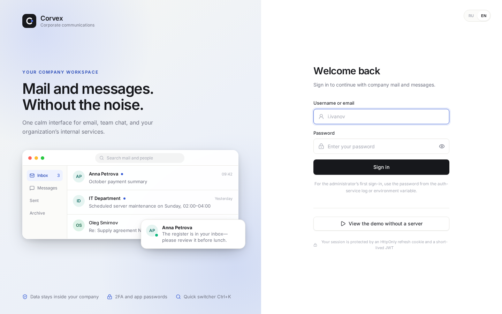
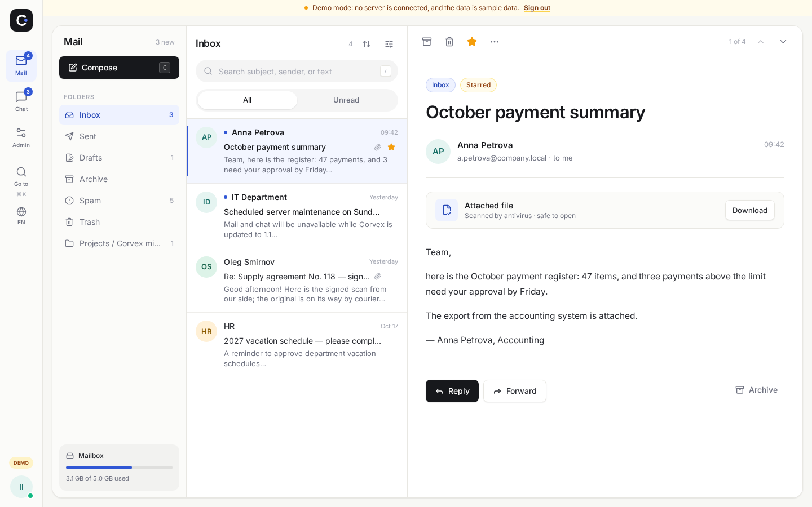
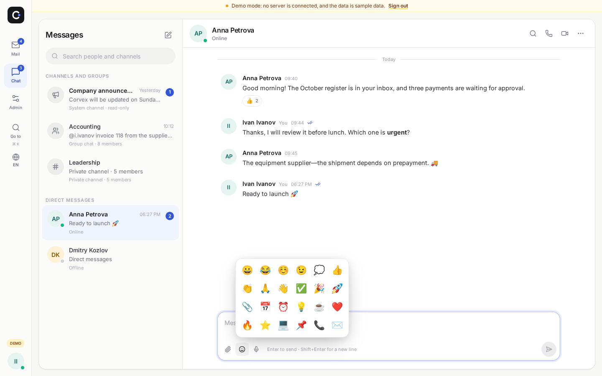
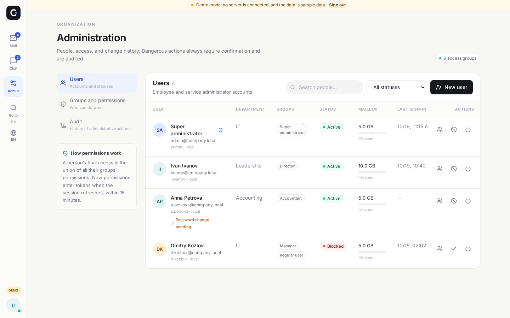

<div align="center">


# Corvex

**Corporate mail, chat, calendar and files that stay on your server.**<br />
**Корпоративная почта, чат, календарь и файлы, которые остаются дома.**<br />
<sub>Free &amp; open source (Apache-2.0): 12 Java services and one React frontend in a single Compose stack, for up to 1,000 employees on your own Windows Server.<br />
Бесплатный open-source проект (Apache-2.0): 12 Java-сервисов и один React-фронтенд в едином Compose-стеке, до 1000 сотрудников на вашем Windows Server.</sub>

[Русский](#русский) · [English](#english) · [Production status](#production-ready-пока-нет) · [Screenshots](#скриншоты) · [Quick start](#попробовать-за-2-минуты) · [First full test](docs/TESTING-ON-YOUR-PC.md) · [Contribute](CONTRIBUTING.md) · [Install](#установка-на-windows-server) · [Docs](#документация) · [Author](#автор-и-связь)

[](https://github.com/ArtemDobrokvashin/Corvex-/stargazers)
[](https://github.com/ArtemDobrokvashin/Corvex-/commits)
[](#production-ready-пока-нет)
[](docs/RELEASE-DEPENDENCIES.md)
[](docs/READINESS.md)
[](docs/READINESS.md)


[](LICENSE)

[](https://t.me/Artem_Dobrokvashin)

[](docs/screenshots/mail-ru.png)

<sub>Real screenshot of the built frontend with clearly labelled demo data. Screenshots prove UI rendering only; verified runtime results are listed separately in READINESS.md.</sub>

</div>

> Corvex is an author-led open-source project currently developed by one enthusiast. Contributions are welcome for those who would like to join the work. / Corvex — авторский open-source проект, который сейчас ведёт один разработчик-энтузиаст. Если захотите присоединиться к разработке, милости просим: порядок участия описан в [`CONTRIBUTING.md`](CONTRIBUTING.md).

---

## Русский

### Почта и команды — на вашем сервере, а не в чужом облаке

**Corvex** — бесплатный open-source проект (лицензия Apache-2.0) для тех, кто хочет **поднять и настроить собственный корпоративный почтовый сервис на своих серверах**. Это self-hosted платформа коммуникаций для организаций до 1000 сотрудников: собственный почтовый сервер, современный веб-клиент, командный чат, гибкая админ-панель, 2FA, мониторинг и резервное копирование в одном Docker-развёртывании.

Концепция Corvex проста: **переписка компании должна принадлежать компании, а инструмент для неё — быть свободным**. Исходный код открыт, подписки и платы за пользователя нет, скрытой телеметрии нет: вы скачиваете проект, разворачиваете его на своём Windows Server (или Linux с Docker), настраиваете домен, DNS и сертификаты по инструкциям — и почта с чатом живут на вашей инфраструктуре, а не в чужом облаке и не зависят от того, доступен ли внешний SaaS сегодня утром.

| Типичная боль | Как отвечает Corvex |
|---|---|
| Почта и чаты живут у внешнего провайдера | Данные, пользователи и аудит остаются на сервере организации |
| Старый парк Windows 7 / Chrome 109 нельзя просто выбросить | Отдельный legacy-бандл и адаптивный интерфейс для ПК, планшетов и телефонов |
| Админка либо «всё можно», либо «ничего нельзя» | 6 групп и 25 атомарных прав-чекбоксов; права суммируются по группам |
| Интерфейс переведён наполовину, ошибки API — на другом языке | Полные RU/EN: интерфейс, даты, числа, demo-данные и публичные ошибки API |
| Проект обещает «enterprise-ready», но прячет ограничения | Открытый аудит, честные ворота готовности и SMTP, выключенный до durable-доставки |

> [!CAUTION]
> **Corvex пока НЕ production-ready.** На текущем `main` (`ad42ff2`, Boot 3.5.16) на ПК собраны и запущены `admin-service`, `mail-storage-service`, `notification-service`, `web-gateway` и frontend: `BUILD SUCCESS` с тестами модулей, миграции `V6`/`V8` применились, контейнеры `healthy`. Полный reactor `mvn -B clean verify` по всем 12 сервисам и чистый профиль без существующих volumes на этом SHA ещё не повторялись. **G3 идёт:** почта, чат и календарь проверены тематически, но собственный сквозной SMTP, Thunderbird/Outlook IMAP/POP3, полный двухпользовательский чат, archive migration и backup/restore не приняты. Это **pre-1.0 стенд, а не замена рабочей почте**. Не направляйте production MX, не переносите рабочие ящики и не включайте публичный SMTP до оставшихся ворот в [`docs/READINESS.md`](docs/READINESS.md).

### Попробовать за 2 минуты

Нужен только актуальный Node.js: 22.22.2+ LTS, 24.15+ или 26+ (см. `engines` в `frontend/package.json`):

```bash
git clone -b main https://github.com/ArtemDobrokvashin/Corvex-.git
cd Corvex-/frontend
npm ci
npm run dev
```

Откройте `http://localhost:5173` и нажмите **«Посмотреть демо без сервера»**. Почта и чат покажут учебные данные с жёлтой плашкой. В полном стеке вход, админка, webmail и базовый чат уже запускались с реальным backend. Собственные почтовые протоколы Stage 3 и полная двухпользовательская приёмка чата остаются в G3; демо-режим не выдаётся за серверный результат.

### Об авторе и участии в проекте

Corvex придумал и сейчас ведёт один разработчик-энтузиаст — **Artem Dobrokvashin**. Это личный open-source проект, а не продукт большой команды: код, архитектура и документация развиваются открыто и в обычном для такого проекта темпе.

Если идея собственной корпоративной почты вам близка и есть желание присоединиться, милости просим. Форматы участия обычные: код, тесты, проверка на своём стенде или почтовом клиенте, документация и переводы. С чего начать, описано в [`CONTRIBUTING.md`](CONTRIBUTING.md); маршрут полной первой проверки — в [`docs/TESTING-ON-YOUR-PC.md`](docs/TESTING-ON-YOUR-PC.md). Для сообщения об ошибке достаточно SHA коммита, версий инструментов, выполненных команд и первой ошибки. Не прикладывайте `.env`, пароли, ключи и настоящие письма, а тесты проводите на отдельной VM и тестовом домене.

Скрытой телеметрии в Corvex нет. При желании информацию о своём стенде или внедрении можно добавить в [`ADOPTERS.md`](ADOPTERS.md).

### Скриншоты

Все кадры ниже — реальные скриншоты собранного фронтенда в Chromium с явно обозначенными демонстрационными данными. Скриншот доказывает только отрисовку UI; фактические Maven/Docker/runtime-результаты перечислены отдельно в [`docs/READINESS.md`](docs/READINESS.md).

Кадры сняты до подключения календаря к backend: сами экраны настоящие, но виджета календаря в боковой панели на них ещё нет. Весь набор — включая `calendar-ru.png` и `calendar-en.png` — переснимается одной командой из корня репозитория, при запущенном `npm run dev` в каталоге `frontend`:

```powershell
.\scripts\capture-screenshots.ps1
```

Скрипт открывает демо-режим по ссылке `?demo=1`, использует установленный Chrome или Edge в режиме `--headless` и ничего не скачивает. Правила и матрица кадров: [`docs/screenshots/README.md`](docs/screenshots/README.md).

<table>
  <tr>
    <td width="50%"><a href="docs/screenshots/login-ru.png"></a><br /><sub>Вход и RU/EN переключатель</sub></td>
    <td width="50%"><a href="docs/screenshots/chat-ru.png"></a><br /><sub>Сообщения, реакции и цветные Unicode-эмодзи</sub></td>
  </tr>
  <tr>
    <td width="50%"><a href="docs/screenshots/admin-ru.png"></a><br /><sub>Пользователи, группы, статусы и квоты</sub></td>
    <td width="50%" align="center"><a href="docs/screenshots/mail-mobile-ru.png"></a><br /><sub>Мобильная почта</sub></td>
  </tr>
</table>

Как воспроизводимо переснять кадры: [`docs/screenshots/README.md`](docs/screenshots/README.md).

### Возможности

#### Реализовано в коде для реального бэкенда

- **Identity:** Argon2id, lockout после 5 неудач на 15 минут, JWT RS256 на 15 минут, вращающиеся refresh-сессии в HttpOnly `SameSite=Strict` cookie и детект повторного использования refresh-токена.
- **2FA и клиенты:** TOTP setup/confirm/disable, MFA-шаг при входе и пароли приложений; SMTP submission, POP3 и IMAP в коде используют их для протокольных логинов.
- **Администрирование:** пользователи и редактирование профилей, квоты, блокировка/отключение, 6 системных и пользовательские группы, 25 прав, фильтруемый аудит с pagination, настройки, health и базовая аналитика. У каждого раздела есть прямой `/admin/<section>` URL. Дисковая квота редактируется в **«Администрирование → Квоты»** (`ADMIN_USERS_MANAGE` или `ADMIN_QUOTAS_MANAGE`); `0` означает безлимит, изменение применяется к новым письмам без перезапуска. **«Настройки»** честно отделяет реестр `server_settings` от реальной runtime-панели алертов для `SUPER_ADMIN` (получатели, каналы, категории и частота с подтверждением revision); **«Внешняя почта»** открывает существующее управление ящиками для `ADMIN_MAIL_POLICY`. Матрица покрытия — [`docs/ADMIN-UI-AUDIT.md`](docs/ADMIN-UI-AUDIT.md).
- **Защита от самоблокировки:** последнего `SUPER_ADMIN` нельзя лишить группы, заблокировать или отключить через API.
- **RU/EN до конца:** переключаются интерфейс, demo-данные, системные группы, формат дат/чисел/байт и `ProblemDetail` ошибки auth/admin по `Accept-Language`.
- **Эмодзи без картинок и CDN:** нативный Unicode picker, вставка в курсор, реакции и графемно-безопасная обрезка сложного текста.
- **Почта Stage 2:** durable SMTP spool, SpamAssassin → ClamAV → Maildir/CAS, серверный webmail, исходящая MX-очередь с retry/DSN, DKIM и submission 587 с AUTH+STARTTLS. Сервисы собраны (`BUILD SUCCESS`) и запущены в Compose на текущем `main` (`ad42ff2`, 16/16 build-контекстов, 20 контейнеров), но собственный сквозной SMTP-сценарий ещё не принят в G3.
- **External Mail Connector:** старые ящики Mail.ru, Яндекса, Gmail, Outlook или custom-сервера подключаются к Corvex по IMAP/POP3: пресеты, app-password с AES-256-GCM, сбор новой почты, импорт архива, дедупликация и send-as через SMTP провайдера. На ПК подтверждён ограниченный ongoing-сбор Mail.ru/Яндекса без дублей; новое письмо Mail.ru появилось после polling с ожидаемой задержкой 1–2 минуты. Архивная миграция и остальные провайдеры ещё требуют live-приёмки. Инструкция: [`docs/EXTERNAL-MAIL.md`](docs/EXTERNAL-MAIL.md).
- **Почтовые протоколы Stage 3:** внутренний протокольный API хранилища (папки/UID/MODSEQ/флаги/APPEND/COPY/QUOTA), POP3 (INBOX, стабильные UIDL, implicit TLS 995) и IMAP-движок Apache James 3.8.2 (143 STARTTLS/993, MOVE/QUOTA/CONDSTORE) собираются и стартуют в Docker на текущем `main` (`ad42ff2`); протоколы выключены по умолчанию до клиентского G3 в Thunderbird/Outlook. Подписки LSUB пока живут в памяти процесса IMAP.
- **Чат Stage 4:** PostgreSQL-backed комнаты и сообщения, STOMP/RabbitMQ realtime, проверка членства, реакции, закрепления, прочтения, typing/presence, поиск и файлы с ClamAV. На ПК подтверждены история, SockJS handshake, отправка сообщений и emoji; полный двухпользовательский security/file/reconnect-smoke остаётся в G3.
- **Календарь:** события с датой, временем и часовым поясом (IANA-зона на событие), повторения, участники, приоритет и занятость; серверное хранение в PostgreSQL и синхронизация между браузерами одного пользователя. Напоминания отправляет сервер — они приходят на почту при закрытом браузере, с повторами 1/2/4/8 минут и восстановлением после перезапуска. Модель и ограничения: [`docs/CALENDAR.md`](docs/CALENDAR.md).
- **Современный frontend без отказа от старого парка:** React 19, Vite 8 и TypeScript 7 собираются в modern-бандл для актуальных браузеров и legacy-бандл для Chrome 109; Markdown проходит через единый DOMPurify-контур с тестами.

#### Следующие этапы и открытые ворота

- **G3 — оставшаяся функциональная приёмка:** собственная сквозная почта, Thunderbird/Outlook, двухпользовательский чат и файлы, webmail/вложения, archive migration и backup/restore.
- **G4 — поддерживаемая платформа:** согласованные Spring Boot/Cloud/Jackson, Apache James/JDK и замена EOL Promtail на Grafana Alloy отдельным апгрейдом с повтором G1–G3.
- **Stage 5 и enterprise-hardening:** AD/LDAP, mTLS между сервисами, мгновенный отзыв JWT, строгая CSP, transactional outbox, персистентные LSUB, распределённый IMAP IDLE, keyword-флаги/ACL, CI и нагрузочные профили до 1000 сотрудников.
- **Следующий продуктовый этап — «Файлы»:** личный диск с папками и безопасными ссылками. Принятая модель — как в Google Drive: файл приватный по умолчанию, выданная ссылка даёт просмотр и скачивание, отзыв ссылки сразу отключает доступ. План и ограничения: [`docs/FILES_PLAN.md`](docs/FILES_PLAN.md).
- **CI:** в репозитории нет автоматического прогона компиляции; поломка сборки в `main` дошла до ноутбука именно из-за этого. Предложен workflow с `mvn -DskipTests package` и `vitest` на каждый PR — ждёт решения владельца репозитория.

### Статус и roadmap

| Этап | Содержимое | Статус |
|---|---|---|
| 1 | Identity, пользователи, группы, RBAC, аудит, админка | 🟡 локальный вход/админка запускались; сборка и запуск на `ad42ff2` зелёные; полная identity/RBAC-приёмка остаётся в G3 |
| 2 | Durable SMTP-доставка, storage, spam/AV, поиск, исходящая очередь | 🟡 сервисы собираются и запускаются на `ad42ff2`; собственный сквозной SMTP ещё не принят |
| 3 | IMAP/POP3 на Apache James, Outlook/Thunderbird | 🟡 образы собираются, POP3 995 прошёл согласованный Thunderbird-smoke; IMAP-приёмка и Outlook не закрыты, протоколы выключены по умолчанию |
| 4 | Persistent realtime-чат, файлы, presence | 🟡 базовый realtime подтверждён; двухпользовательский chat/file/security-smoke впереди |
| 6 | Календарь и серверные напоминания | 🟡 реализовано и собрано на `ad42ff2`; живая приёмка на ПК впереди |
| 7 | «Файлы»: личный диск и ссылки | 📐 спроектировано, модель ссылок согласована; код не начат |
| G0 | Frontend и статические ворота | ✅ текущий `main`: 67 файлов / 310 тестов, `tsc -b`, modern+legacy build, production audit 0 |
| G1 | Maven по всем сервисам | 🟢 `ad42ff2`: `admin`, `mail-storage`, `notification`, `web-gateway` — `BUILD SUCCESS` с тестами; 🔁 полный reactor 12 сервисов + parent |
| G2 | Docker, Flyway и первый запуск | ✅ `ad42ff2`: 16/16 build-контекстов собраны, контейнеры `Started`/`healthy`, миграции `V6`/`V8` применились; ⏳ чистая установка без volumes |
| G3 | Функциональная приёмка | 🚧 External Mail ongoing и базовый чат проверены; остальное перечислено в [`docs/READINESS.md`](docs/READINESS.md) |
| G4–G5 | Поддерживаемая платформа, пилот и production | ⏳ не начаты; подробности в [`docs/RELEASE-DEPENDENCIES.md`](docs/RELEASE-DEPENDENCIES.md) |
| 5 | AD/LDAP, mTLS, production hardening | 📐 спроектировано; выполняется после соответствующих ворот |

SMTP/IMAP/POP3 остаются выключенными по умолчанию до соответствующей сквозной G3-приёмки. Успешные Maven/Docker сами по себе не включают протоколы и не доказывают доставку письма.

### Что осталось до переноса на тестовый сервер

Стенд на ноутбуке уже собран из `main`: миграции применяются, сервисы `healthy`. До переноса
на сервер остаются четыре блока — в этом порядке.

**1. Повторить ворота сборки на точном SHA (обязательно).**

```powershell
git checkout main; git pull
mvn -B clean verify                       # все 12 сервисов + parent, тесты и JaCoCo
docker compose build                       # все образы, уже проверено для текущего SHA
docker compose up -d                       # на существующих volumes
```

Отдельно — **чистый профиль без старых данных** (`docker compose down -v` только на пустом
тестовом стенде): он показывает, что миграции `V1…V8` проходят с нуля, а не только поверх
уже созданной базы. Без этого первый же серверный запуск может упасть на Flyway.

**2. Пройти живую приёмку того, что нельзя проверить тестами.** Полные чек-листы —
[`docs/TESTING-ON-YOUR-PC.md`](docs/TESTING-ON-YOUR-PC.md).

- Почта: SMTP→spam→AV→хранилище→webmail, вложение, EICAR, недоступность ClamAV, повтор без дубля.
- Чат: два пользователя, чужой доступ, файл, переподключение.
- Календарь: событие переживает F5 и второй браузер, напоминание приходит на почту при закрытом браузере, конфликт двух окон, рестарт `mail-storage-service` не теряет напоминание.
- Identity/RBAC: вход, 2FA, app-password и его отзыв, запрет доступа к чужой почте.
- Chrome 109 и мобильный экран, RU/EN.

**3. Проверить эксплуатацию, а не только функции.** Backup → restore на чистой машине,
откат образов на предыдущий SHA, алерт при остановке сервиса, ротация сертификата.
Затем 72 часа наблюдения: очереди, DLQ, диск, bounce-rate.

Пошаговый план с датами, зависимостями и критериями выхода на каждый день —
[`docs/SERVER-ROLLOUT.md`](docs/SERVER-ROLLOUT.md).

**4. Подготовить сам сервер.** Тестовый домен и DNS (MX/SPF/DKIM/DMARC), TLS-сертификат,
`first-run.ps1` с новыми секретами, `CORVEX_INTERNAL_API_TOKEN` одинаковый во всех сервисах,
NTP, брандмауэр, получатели алертов. Почтовые протоколы (`CORVEX_SMTP_ENABLED` и т. п.)
включаются **после** шага 2, а не вместе с переносом.

Перенос на тестовый сервер не требует «Файлов», общих календарей, AD/LDAP и внешних
мессенджеров: это следующие этапы, а не условия запуска стенда.

Текущий исходный baseline — Java 17 и Spring Boot 3.5.16; gateway использует Spring Cloud 2025.0.3, остальные POM пока содержат BOM 2023.0.6, IMAP/POP3 — James 3.8.2. На этом baseline `ad42ff2` собирается (затронутые модули) и запускается в Compose (16/16 build-контекстов, 20 контейнеров), поэтому Boot 3.5.16 больше не является непроверенным переходом. Разнородные BOM и James 3.8.2 остаются техническим долгом: согласованная поддерживаемая платформа — отдельный G4. Dependabot ограничен сгруппированными minor/patch-обновлениями и одним открытым PR на ecosystem.

### Production-ready? Пока нет

**Прямой ответ: нет. Corvex сегодня нельзя честно продавать или внедрять как production-ready продукт.** Но это уже не только написанный, но незапущенный код: на текущем `main` затронутые модули прошли Maven с тестами, Compose поднимает 20 контейнеров без профилей, миграции применяются, а часть живых сценариев проверена тематически. До доверия рабочей переписке остаются полный reactor G1, чистая установка G2, полный G3, G4 и контролируемый пилот G5.

Сейчас Corvex подходит для:

- изучения интерфейса и архитектуры;
- разработки и функциональной приёмки;
- изолированного тестового стенда с тестовыми ящиками и без production MX;
- подготовки DNS/сертификатов на отдельном тестовом домене.

Сейчас Corvex **не подходит** для:

- замены рабочего корпоративного почтового сервера;
- переноса рабочих почтовых ящиков и переписки;
- публичного включения портов 25/587 как боевого сервиса;
- обещаний production-ready Outlook/Thunderbird или полностью проверенного корпоративного чата: базовый чат уже работал на стенде, но клиентские и двухпользовательские сценарии ещё не закрыты.

#### Что уже подтверждено, а что нет

| Область | Подтверждено фактически | Не подтверждено / остаётся |
|---|---|---|
| Frontend | Текущий `main`: 67 файлов / 310 тестов; `tsc -b`, modern+legacy build; production `npm audit` — 0 | реальный Windows 7 + Chrome 109, полная responsive/E2E-матрица |
| Java | `ad42ff2`: `admin`, `mail-storage` и `notification` с тестами модулей, `web-gateway` — `BUILD SUCCESS`; ранее полный reactor на `8cccaee` с JaCoCo | полный reactor 12 сервисов на `ad42ff2`; затем сквозные сценарии поверх unit/context-тестов |
| Docker/инфраструктура | `ad42ff2`: `docker compose up -d --build` — 16/16 локальных образов, 20 контейнеров `Started`/`healthy`, миграции применились | чистая установка без volumes; затем 72 часа, нагрузка, monitoring-профиль, restore и откат |
| Внешняя почта | Ongoing IMAP Mail.ru/Яндекс на тестовых ящиках; повторы без дублей; новое письмо доставлено polling-ом | архив, остальные провайдеры, весь send-as/Sent smoke, distributed IDLE |
| Чат | История, SockJS handshake, сообщения и emoji на реальном backend | два пользователя, direct/group security, файлы/EICAR, refresh/reconnect и restart |
| Собственная почта | Сервисы SMTP/IMAP/POP3 собраны и запущены; webmail подключён к backend | SMTP→spam→AV→Maildir→webmail, внешняя доставка/DKIM и Thunderbird/Outlook IMAP/POP3 |
| Эксплуатация | Мониторинг и backup-скрипты есть; базовая инфраструктура стартует | восстановление из бэкапа, откат релиза, 1000 сотрудников, security-тесты и 72-часовой soak |

> Успешная сборка Docker-образа сама по себе не равна пройденным Java-тестам: Dockerfile собирают сервисы с `-DskipTests`. Поэтому `mvn verify` нужно запускать отдельно до или независимо от Compose.

#### Что может пойти не так — и как это исправлять

| Симптом при первой приёмке | Что это может означать | Как диагностировать и исправлять |
|---|---|---|
| Maven не компилирует сервис | несовпадение API SubEtha/Jakarta Mail/Spring AMQP, отсутствующий import/bean или ошибка типов, которую не видит синтаксический парсер | собрать один сервис без тестов, исправить **первую** ошибку компилятора, затем повторить; не «лечить» массовым понижением версий |
| Тесты проходят, но падает JaCoCo `verify` | покрытие ниже порога 70% в POM, а не обязательно сломана логика | добавить тесты на критичную логику; порог менять только отдельным осознанным решением, а не молча отключать перед релизом |
| Spring-контекст не стартует | дублирующийся/отсутствующий bean, AMQP-декларация, неверный env, недоступны PostgreSQL/Redis/RabbitMQ/Elasticsearch | читать полный cause-chain в `docker compose logs --tail 200 <сервис>`; исправить bean/config и добавить контекстный или интеграционный тест |
| Flyway или JPA `validate` падает | схема миграции расходится с entity/JPQL | добавить **новую** миграцию; уже применённую миграцию не редактировать. `docker compose down -v` допустим только на пустом стенде |
| `401/503` на internal API или после входа | разные/пустые `CORVEX_INTERNAL_API_TOKEN`, JWT-ключ не сохранён между рестартами, JWKS недоступен, рассинхронизировано время | проверить один и тот же секрет во всех сервисах, persistent PEM-ключ auth-service, NTP и логи auth/admin/gateway без публикации самих секретов |
| SMTP отвечает `451`, письмо не появляется или уходит в DLQ | storage/RabbitMQ/spam/AV недоступны, нет прав на spool/Maildir, превышена квота или событие не совпало с JSON-контрактом | проверить логи SMTP/storage/spam/AV, очереди и DLQ в RabbitMQ, место и владельца томов; не удалять spool вручную, пока не найден `rawRef` и причина |
| После рестарта письмо продублировалось или потерялось | at-least-once доставка AMQP и отсутствие полноценного transactional outbox между spool, RabbitMQ, Maildir и БД | воспроизвести остановку сервиса в каждой точке конвейера; до продакшена добавить/усилить идемпотентность или outbox и регрессионный тест именно на этот сбой |
| Webmail возвращает `403/422/413` при отправке | нет permission, отправитель не `ACTIVE`, домен получателя не принимается (нет ни в `CORVEX_MAIL_DOMAINS`, ни среди подтверждённых в James), плохой адрес или письмо больше лимита spool | проверить группы пользователя, статус ящика, домены в админке и размер MIME после Base64; права настраивать через админку, а не ослаблять проверки в коде. `503` при отправке означает, что список доменов временно недоступен — это не отказ в правах |
| Submission не принимает AUTH/STARTTLS | нет сертификата, приватный ключ не PKCS#8 PEM, не проброшен 587, включён TOTP и используется основной пароль вместо app-password, `MAIL FROM` не принадлежит пользователю | убедиться по логу, что submission listener стартовал; проверить `/certs/fullchain.pem`, `/certs/privkey.pem`, app-password, права и совпадение envelope sender |
| Внешняя почта уходит в спам или bounce | нет PTR/rDNS, SPF не покрывает отправителя, публичный DKIM не совпадает с приватным ключом, DMARC alignment нарушен, провайдер закрыл исходящий 25 или IP без репутации | смотреть diagnostic в DSN и заголовки у получателя; начинать с SPF `~all` и DMARC `p=none`, опубликовать точный `corvex1._domainkey`, настроить PTR и mail-tester ≥ 9/10 до ужесточения политики |
| На Windows 7 интерфейс не работает как на скриншотах | браузеру отдан modern-бандл вместо legacy, кэш nginx/браузера или отсутствует нужный polyfill | проверить заголовки и фактически загружаемый `*-legacy*.js`, затем повторить smoke на реальной Windows 7 + Chrome 109; скриншот из современного Chromium этот гейт не заменяет |

#### Как довести Corvex до production-ready

Отметки ниже показывают результат на проверенном baseline, а не вечную гарантию для любого
будущего коммита. G0–G2 повторяются на каждом релизном SHA.

- [ ] **0. Не открывать прод раньше времени.** Держать `CORVEX_SMTP_ENABLED=false`, не менять рабочие MX и работать на отдельной VM/тестовом поддомене.
- [ ] **1. Повторить зелёный Maven на текущем `main`.** Затронутые модули (`admin`, `mail-storage`, `notification`, `web-gateway`) уже дают `BUILD SUCCESS` на `ad42ff2`; полный reactor по 12 сервисам для этого SHA ещё не запускался. Из корня выполнить:

  ```powershell
  mvn -B clean verify
  ```

  Пункты 1–3 одной командой также выполняет `scripts\verify.ps1` (Windows Server) или `scripts/verify.sh` (Linux); с флагом `-DockerBuild` / `--docker-build` дополнительно собираются все Docker-образы.

  Дополнительные non-destructive runtime, read-only protocol smoke, сквозной SMTP/IMAP e2e и guarded IMAP MOVE/flags/restart-persistence с JSON-отчётами описаны в [`scripts/README.md`](scripts/README.md). Полный persistence-режим требует `--allow-mutating` и `--allow-restart`; без них выполняется только precheck.

- [x] **2. Зелёный frontend текущего `main`:** `npm ci`, **67 файлов / 310 тестов**, `tsc -b`, `npm run build` с modern+legacy и production audit 0. Каждый релизный кандидат повторяет G0 без сокращений.
- [x] **3. Базовый Compose-подъём на текущем `main`:** `docker compose up -d --build` — 16/16 build-контекстов собраны, контейнеры `Started`/`healthy`, миграции `V6`/`V8` применились. Осталось повторение на чистом профиле без volumes (`down -v` только на пустом стенде) и проверка restart loops/DLQ.
- [ ] **4. Полный identity/admin smoke.** Bootstrap-админ, смена пароля, второй пользователь, группы/права, lockout, TOTP, app-password, аудит и запрет действий над чужими данными.
- [ ] **5. Собственный почтовый smoke на тестовом домене.** Внешнее письмо → INBOX; локальное webmail-письмо; внешнее письмо на контролируемый MX; вложение; Bcc не виден другим получателям; письмо переживает рестарт контейнеров.
- [ ] **6. Негативные почтовые сценарии.** Несуществующий локальный получатель — `550`; open relay запрещён; storage/Rabbit недоступны — `451`, а не ложный `250 OK`; временный `4xx` уходит в retry; постоянный `5xx` создаёт DSN; повтор события не создаёт дубль.
- [ ] **7. Submission и доставляемость.** STARTTLS обязателен, app-password работает, чужой `MAIL FROM` отклоняется `553`, DKIM/SPF/DMARC проходят у внешнего получателя, PTR совпадает с SMTP hostname, mail-tester ≥ 9/10.
- [ ] **8. Полный чат Stage 4.** Два пользователя: direct/группа, история после рестарта, запрет чужой комнаты/файла, идемпотентный `clientMessageId`, реакции/pin/read, EICAR и STOMP после refresh JWT. Базовые сообщения уже проверены, но этот пункт пока не закрыт целиком.
- [ ] **8A. Клиентский smoke Stage 3 (IMAP/POP3).** Только на стенде включить протоколы с PKCS12/keystore и проверить Thunderbird/Outlook: LOGIN, LIST/SELECT/FETCH, вложения, Sent, MOVE/EXPUNGE, поиск, POP3 UIDL и DELE/QUIT. Для автоматизированного guarded MOVE/flags/restart-persistence используйте `scripts/mail_persistence.py`: сначала precheck, затем полный режим только с двумя explicit-флагами. Подробные команды и критерии — в [`docs/TESTING-ON-YOUR-PC.md`](docs/TESTING-ON-YOUR-PC.md).
- [ ] **8B. Оставшийся External Mail smoke.** Archive migration, send-as/Sent, pause/resume/delete, права владельца и остальные провайдеры; затем настраиваемый polling и устойчивый IMAP IDLE с reconnect/fallback.
- [ ] **9. Эксплуатационная приёмка.** Backup → restore на чистой VM, откат образов, алерт при остановке, ротация сертификата, нагрузка из [`docs/10-test-strategy.md`](docs/10-test-strategy.md), security-проход, мониторинг/alerting и реальная Windows 7 + Chrome 109.
- [ ] **9A. Поддерживаемая dependency-платформа (G4).** Отдельно выбрать и проверить поддерживаемые Spring/James/JDK, заменить Promtail на Alloy и повторить Maven, Docker, почтовые и чат-smoke без сокращений.
- [ ] **10. Пилот, а не сразу «прод для всех».** Минимум 72 часа на тестовом/пилотном домене с мониторингом очередей, DLQ, диска, bounce-rate и жалоб пользователей; только после этого переносить ограниченную группу ящиков.

Даже после закрытия перечисленных пунктов первый честный статус — **pilot-ready для ограниченного контура**, а не автоматически production-ready всей платформы. Полный G3, G4 и Stage 5 либо осознанное сужение заявленного объёма остаются обязательными.

Если сборка упала, для issue приложите SHA коммита, первую ошибку Maven или полный стек Spring, `docker compose ps` и хвост логов соответствующего сервиса. **Не прикладывайте** `.env`, пароли, internal token, приватные ключи и настоящие письма.

### Установка на Windows Server

> Все завершённые этапы уже слиты в `main`; для тестирования используйте именно эту ветку. Пошаговая приёмка: [`docs/TESTING-ON-YOUR-PC.md`](docs/TESTING-ON-YOUR-PC.md).

```powershell
git clone -b main https://github.com/ArtemDobrokvashin/Corvex-.git C:\Corvex
cd C:\Corvex

.\scripts\first-run.ps1     # уникальные секреты, JWT-ключ, internal API token, пилотный TLS, .env
notepad .env                # CORVEX_DOMAIN, CORVEX_MAIL_DOMAIN, получатели алертов

docker compose config
docker compose up -d --build                 # 12 микросервисов + инфраструктура
docker compose --profile monitoring up -d    # Prometheus, Grafana, Loki, Alertmanager
docker compose ps                            # healthchecked-сервисы healthy; nginx/frontend/spamd — Up
```

Откройте `https://mail.<ваш-домен>`. Первый пользователь — `admin`; пароль задаётся `CORVEX_BOOTSTRAP_ADMIN_PASSWORD` или один раз печатается в лог:

```powershell
docker compose logs auth-service | Select-String BOOTSTRAP
```

Полная инструкция: [`docs/INSTALL.md`](docs/INSTALL.md) — Hyper-V/Docker, брандмауэр, TLS, DNS, сертификаты, бэкапы и траблшутинг.

### Архитектура

12 сервисов Java 17 / Spring Boot за единым gateway:

- `auth-service` владеет учётками, паролями, TOTP и сессиями;
- `admin-service` — группами, правами, настройками и аудитом;
- `web-gateway` проверяет JWT и ограничивает частоту запросов;
- `mail-smtp`, `mail-imap`, `mail-pop3` отделяют протоколы от бизнес-логики;
- `mail-storage` — Maildir и вложения по SHA-256 с дедупликацией, а также события календаря и очередь напоминаний;
- `mail-spam`, `mail-antivirus` — тонкие клиенты SpamAssassin и ClamAV;
- `chat-service`, `chat-file-service` — STOMP и файлы;
- `notification-service` превращает Alertmanager webhook в email администраторам и отправляет напоминания календаря;
- `alert-relay` независимо отправляет внешний SMTP/Telegram/MAX без RabbitMQ и почты Corvex; получатели, категории и частота настраиваются суперадмином в `/admin/settings`, последний рабочий config кэшируется. Telegram-мастер находит чаты после `/start`, а команды `/start`, `/id`, `/help` работают без публичного webhook; silence управляется по [`docs/ALERTING.md`](docs/ALERTING.md).

Данные: PostgreSQL 16 (database-per-service), Redis, RabbitMQ, Elasticsearch, Maildir + CAS. Наблюдаемость: Prometheus, Grafana, Loki. Один `docker-compose.yml`: 30 определённых сервисов, из них 20 поднимаются без профилей (16 собираются из исходников и 4 готовых образа: PostgreSQL, Redis, RabbitMQ, Elasticsearch), остальные включаются профилями — James JMAP/админка и мониторинг; 5 сетей и 16 томов. Полный набор запускается одной командой, поэтому отдельного compose-файла для сервера нет.

Диаграммы и ADR: [`docs/01-architecture.md`](docs/01-architecture.md).

### Безопасность и приватность

- Refresh-токен не хранится в открытом виде: в PostgreSQL лежит SHA-256 от 32 случайных байт.
- Внутренние auth/admin API не маршрутизируются наружу и требуют `X-Corvex-Internal-Token`; без секрета — fail-closed `503`.
- nginx — единственный доверенный edge для клиентского IP; поддельный первый `X-Forwarded-For` не попадает в rate-limit и аудит.
- Повторный TOTP setup не заменяет уже включённую 2FA без текущего кода.
- Настройки валидируются на сервере и пишутся одной транзакцией; SMTP/Telegram/MAX alert-секреты из UI хранятся в AES-256-GCM и никогда не возвращаются public API.
- Markdown санитизируется; внешние изображения в чате запрещены как tracking pixels.
- **Нет скрытой телеметрии, рекламных трекеров и license phone-home.** Если когда-нибудь появится проверка обновлений, она должна быть явной, документированной и отключаемой.

Полный аудит: [`docs/12-full-audit-2026-10.md`](docs/12-full-audit-2026-10.md).

### Документация

| Документ | Содержание |
|---|---|
| [`docs/TECHNICAL_DESIGN.md`](docs/TECHNICAL_DESIGN.md) | мастер-документ технического проекта |
| [`docs/12-full-audit-2026-10.md`](docs/12-full-audit-2026-10.md) | полный аудит фронтенда, бэкенда и инфраструктуры |
| [`docs/READINESS.md`](docs/READINESS.md) | честный статус по компонентам и ворота пилота |
| [`docs/RELEASE-DEPENDENCIES.md`](docs/RELEASE-DEPENDENCIES.md) | зафиксированные версии, осознанные исключения и порядок G0–G5 |
| [`docs/TESTING-ON-YOUR-PC.md`](docs/TESTING-ON-YOUR-PC.md) | пошаговая первая приёмка на вашем ПК: от frontend до Maven, Docker и почтовых клиентов |
| [`docs/EXTERNAL-MAIL.md`](docs/EXTERNAL-MAIL.md) | подключение Mail.ru, Яндекса и других старых ящиков: сбор, миграция архива и send-as |
| [`docs/SERVER-ROLLOUT.md`](docs/SERVER-ROLLOUT.md) | план переноса на тестовый сервер на неделю: дни, зависимости, критерии выхода, порядок включения |
| [`docs/CALENDAR.md`](docs/CALENDAR.md) | календарь: модель данных, API, доставка напоминаний, развёртывание и ограничения |
| [`docs/FILES_PLAN.md`](docs/FILES_PLAN.md) | «Файлы»: проектирование личного диска и модель ссылок |
| [`CONTRIBUTING.md`](CONTRIBUTING.md) | участие в разработке: код, тесты, документация, переводы и требования к PR |
| [`docs/INSTALL.md`](docs/INSTALL.md) | установка и эксплуатация; есть [`INSTALL.en.md`](docs/INSTALL.en.md) |
| [`docs/11-modern-design-analysis.md`](docs/11-modern-design-analysis.md) | Gmail/Outlook/Slack/Superhuman/Linear и дизайн-система Quiet Work |
| [`docs/api/*.yaml`](docs/api/) | OpenAPI: auth, mail, chat, admin |
| [`ADOPTERS.md`](ADOPTERS.md) | кто использует Corvex и как добавить организацию |
| [`SUPPORT.md`](SUPPORT.md) | куда писать о багах, безопасности, донатах и коммерческой помощи |

### Автор и связь

Автор Corvex — **Artem Dobrokvashin**: [Telegram](https://t.me/Artem_Dobrokvashin). По вопросам проекта, внедрений, планирования миграций, обучения администраторов и заказных интеграций можно связаться напрямую. Вопросы добровольных пожертвований также обсуждаются только напрямую с автором; платёжные реквизиты в репозитории не публикуются.

Corvex бесплатен и открыт под Apache-2.0, и ядро для собственного сервера таким и останется. Продукт не требует подписки, платы за пользователя или «активации».

### Лицензия

Corvex распространяется под лицензией **Apache License 2.0** — полный текст в файле [`LICENSE`](LICENSE), атрибуция и перечень сторонних компонентов — в [`NOTICE`](NOTICE). Это значит: бесплатное развёртывание на собственном сервере без подписки и платы за пользователя, право модифицировать, распространять и использовать в коммерческих целях при соблюдении условий Apache-2.0. Вклад в проект принимается под той же лицензией (см. [`CONTRIBUTING.md`](CONTRIBUTING.md)).

---

## English

### Mail and team conversations that stay home

**Corvex** is a free open-source project (Apache-2.0) for people who want to **raise and run their own corporate mail service on their own servers**. It is a self-hosted communication platform for organizations of up to 1,000 employees: an own mail server, a modern webmail client, team chat, a flexible administration panel, 2FA, monitoring, and backups in one Docker deployment.

The concept is deliberately simple: **a company's correspondence should belong to the company, and the tool for it should be free**. The source code is open, there is no subscription or per-seat fee and no hidden telemetry: you download the project, deploy it on your Windows Server (or Linux with Docker), configure your domain, DNS, and certificates with the supplied guides — and mail and chat live on your infrastructure instead of a third-party cloud, independent of somebody else's SaaS being up this morning.

| Common pain | Corvex answer |
|---|---|
| Mail and chat live with an external provider | Data, users, and audit stay on your organization's server |
| The Windows 7 / Chrome 109 fleet cannot simply be discarded | A dedicated legacy bundle plus responsive phone/tablet layouts |
| Administration is either “everything” or “nothing” | 6 groups and 25 atomic checkbox permissions, unioned across groups |
| Half the UI is translated and API errors are not | Complete RU/EN across UI, dates, numbers, demo data, and public API errors |
| “Enterprise-ready” hides the fine print | A public audit, explicit readiness gates, and SMTP disabled until durable delivery |

> [!CAUTION]
> **Corvex is NOT production-ready.** On the current `main` (`ad42ff2`, Boot 3.5.16) the touched modules build on a PC with `BUILD SUCCESS` (with module tests), migrations `V6`/`V8` apply, and `docker compose up -d --build` builds all 16 local images and starts the default 20 services `healthy`. The full 12-service reactor and a clean-volume install have not been repeated on this SHA. **G3 is in progress:** limited Mail.ru/Yandex ongoing collection, basic realtime chat, chat files, webmail attachments, and the calendar server side have separate topical evidence, but own end-to-end SMTP, Thunderbird/Outlook IMAP/POP3, full two-user chat, archive migration, calendar live acceptance, and backup/restore are not accepted. This is a **pre-1.0 bench—not a replacement for working mail**. Do not point production MX records at Corvex, migrate working mailboxes, or expose public SMTP until the remaining gates in [`docs/READINESS.md`](docs/READINESS.md) pass.

### Try it in 2 minutes

Only a current Node.js patch line is required: 22.22.2+ LTS, 24.15+, or 26+ (see `engines` in `frontend/package.json`):

```bash
git clone -b main https://github.com/ArtemDobrokvashin/Corvex-.git
cd Corvex-/frontend
npm ci
npm run dev
```

Open `http://localhost:5173` and click **“View the demo without a server.”** Mail and Messages show clearly labelled sample data. In the full stack, sign-in, administration, webmail, and basic chat have already run against the real backend. Own Stage 3 mail protocols and complete two-user chat acceptance remain in G3; demo mode is not presented as server evidence.

### About the author and joining the project

Corvex was created and is currently developed by one enthusiast, **Artem Dobrokvashin**. It is a personal open-source project rather than the product of a large team: the code, architecture, and documentation evolve in the open at a sustainable individual pace.

If the idea of running your own corporate mail service appeals to you and you would like to take part, you are welcome to do so. The usual forms of participation apply: code, tests, checks on your own bench or mail client, documentation, and translations. Start with [`CONTRIBUTING.md`](CONTRIBUTING.md); the full first-test route is described in [`docs/TESTING-ON-YOUR-PC.md`](docs/TESTING-ON-YOUR-PC.md) (Russian). A useful bug report contains the commit SHA, tool versions, commands, and the first error. Never attach `.env`, passwords, keys, or real mail, and use a separate VM and test domain.

Corvex contains no hidden telemetry. If you wish, you can record a bench or deployment in [`ADOPTERS.md`](ADOPTERS.md).

### Screenshots

Every frame below is a real screenshot of the built frontend in Chromium with clearly labelled demo data. A screenshot proves UI rendering only; actual Maven/Docker/runtime results are listed separately in [`docs/READINESS.md`](docs/READINESS.md).

The frames were captured before the calendar was connected to the backend: the screens are real, but the calendar widget is missing from the sidebar in them. The whole set — including `calendar-ru.png` and `calendar-en.png` — is re-captured with one command from the repository root while `npm run dev` is running in `frontend`:

```powershell
.\scripts\capture-screenshots.ps1
```

The script opens demo mode through the `?demo=1` deep link, drives the installed Chrome or Edge in `--headless` mode, and downloads nothing. Rules and the frame matrix: [`docs/screenshots/README.md`](docs/screenshots/README.md).

<table>
  <tr>
    <td width="50%"><a href="docs/screenshots/login-en.png"></a><br /><sub>Sign-in with the RU/EN switch</sub></td>
    <td width="50%"><a href="docs/screenshots/mail-en.png"></a><br /><sub>Mail in the Quiet Work three-pane layout</sub></td>
  </tr>
  <tr>
    <td width="50%"><a href="docs/screenshots/chat-en.png"></a><br /><sub>Messages, reactions, and native color emoji</sub></td>
    <td width="50%"><a href="docs/screenshots/admin-en.png"></a><br /><sub>Users, groups, statuses, and quotas</sub></td>
  </tr>
</table>

Reproduce the captures with [`docs/screenshots/README.md`](docs/screenshots/README.md).

### Features

#### Implemented in code for the real backend

- **Identity:** Argon2id, 15-minute lockout after 5 failures, 15-minute RS256 JWTs, rotating refresh sessions in an HttpOnly `SameSite=Strict` cookie, and refresh-token reuse detection.
- **2FA and clients:** TOTP setup/confirm/disable, an MFA sign-in step, and app passwords; SMTP submission, POP3, and IMAP use them for protocol logins in code.
- **Administration:** users and profile editing, quotas, block/disable, 6 system plus custom groups, 25 permissions, filterable paginated audit, settings, service health, and basic sign-in analytics. Every section has a direct `/admin/<section>` URL. Edit mailbox quotas under **Administration → Quotas** (`ADMIN_USERS_MANAGE` or `ADMIN_QUOTAS_MANAGE`); `0` means unlimited, and changes apply to new messages without a restart. **Settings** clearly separates the non-runtime `server_settings` registry from a real `SUPER_ADMIN` alert runtime panel (recipients, channels, categories, and frequency with revision confirmation); **External mail** opens the existing mailbox management UI for `ADMIN_MAIL_POLICY`. See the [coverage matrix](docs/ADMIN-UI-AUDIT.md).
- **No accidental lock-out:** the last `SUPER_ADMIN` cannot lose membership, be blocked, or be disabled through the API.
- **RU/EN end to end:** UI, demo data, system groups, dates/numbers/bytes, and auth/admin `ProblemDetail` errors localized by `Accept-Language`.
- **Emoji without images or a CDN:** a native Unicode picker, cursor-aware insertion, reactions, and grapheme-safe text handling.
- **Stage 2 mail:** durable SMTP spool, SpamAssassin → ClamAV → Maildir/CAS, server-backed webmail, outbound MX queue with retry/DSN, DKIM, and submission on 587 with AUTH+STARTTLS. The services build (`BUILD SUCCESS`) and start in Compose on the current `main` (`ad42ff2`, 16/16 local images, 20 containers up), but the own end-to-end SMTP scenario is not yet accepted in G3.
- **External Mail Connector:** connect existing Mail.ru, Yandex, Gmail, Outlook, or custom IMAP/POP3 mailboxes with presets, AES-256-GCM app-password storage, new-mail collection, archive import, dedupe, and send-as through provider SMTP. Limited ongoing Mail.ru/Yandex collection has passed on a PC without duplicates; a new Mail.ru message arrived through polling with the expected 1–2 minute delay. Archive migration and the other providers still need live acceptance. Guide: [`docs/EXTERNAL-MAIL.md`](docs/EXTERNAL-MAIL.md).
- **Stage 3 mail protocols:** internal storage protocol API (folders/UID/MODSEQ/flags/APPEND/COPY/QUOTA), POP3 (INBOX, stable UIDL, implicit TLS 995), and Apache James 3.8.2 IMAP (143 STARTTLS/993, MOVE/QUOTA/CONDSTORE) build and start in Docker on the current `main` (`ad42ff2`); the protocols remain disabled by default until Thunderbird/Outlook G3 acceptance. LSUB subscriptions currently live only in IMAP process memory.
- **Stage 4 chat:** PostgreSQL-backed rooms/messages, STOMP/RabbitMQ realtime, membership checks, reactions, pins, read state, typing/presence, search, and ClamAV-scanned files. History, the SockJS handshake, message sending, and emoji have passed on a PC; the full two-user security/file/reconnect smoke remains in G3.
- **Calendar:** events with a date, time, and per-event IANA time zone, recurrences, attendees, priority, and busy status; server-side storage in PostgreSQL and synchronization between the same user's browsers. Reminders are sent by the server, so they arrive by mail with the browser closed, with 1/2/4/8-minute retries and crash recovery. Model and limits: [`docs/CALENDAR.md`](docs/CALENDAR.md).
- **A modern frontend that does not abandon the old fleet:** React 19, Vite 8, and TypeScript 7 produce a modern bundle for current browsers and a legacy bundle for Chrome 109; chat Markdown passes through one tested DOMPurify path.

#### Next stages and open gates

- **G3 — remaining functional acceptance:** own end-to-end mail, Thunderbird/Outlook, two-user chat/files, webmail/attachments, archive migration, and backup/restore.
- **G4 — the supported platform:** aligned Spring Boot/Cloud/Jackson, Apache James/JDK, and Grafana Alloy instead of EOL Promtail, as a separate upgrade followed by G1–G3 again.
- **Stage 5 and enterprise hardening:** AD/LDAP, service-to-service mTLS, instant JWT revocation, strict CSP, a transactional outbox, persistent LSUB, distributed IMAP IDLE, keyword flags/ACL, CI, and load profiles for 1,000 employees.
- **Next product stage — Files:** a personal drive with folders and safe links. The agreed model follows Google Drive: a file is private by default, an issued link grants view and download, and revoking the link removes access immediately. Plan and limits: [`docs/FILES_PLAN.md`](docs/FILES_PLAN.md).
- **CI:** the repository has no automated compilation run, which is exactly how a broken build in `main` reached the laptop. A workflow running `mvn -DskipTests package` and `vitest` on every PR is proposed and waits for the repository owner's decision.

### Status and roadmap

| Stage | Scope | Status |
|---|---|---|
| 1 | Identity, users, groups, RBAC, audit, administration | 🟡 local sign-in/admin ran; build and start are green on `ad42ff2`; full identity/RBAC acceptance remains in G3 |
| 2 | Durable SMTP delivery, storage, spam/AV, search, outbound queue | 🟡 services build and start on `ad42ff2`; own end-to-end SMTP is not accepted yet |
| 3 | Apache James IMAP/POP3, Outlook/Thunderbird | 🟡 images build; an agreed POP3 995 Thunderbird smoke passed; IMAP acceptance and Outlook remain open, protocols stay disabled by default |
| 4 | Persistent realtime chat, files, presence | 🟡 basic realtime confirmed; two-user chat/file/security smoke remains |
| 6 | Calendar and server-side reminders | 🟡 implemented and built on `ad42ff2`; live PC acceptance remains |
| 7 | Files: personal drive and links | 📐 designed, link model agreed; no code yet |
| G0 | Frontend and static gates | ✅ current `main`: 67 files / 310 tests, `tsc -b`, modern+legacy build, production audit 0 |
| G1 | Maven for every service | 🟢 `ad42ff2`: `admin`, `mail-storage`, `notification`, `web-gateway` — `BUILD SUCCESS` with tests; 🔁 full 12-service reactor plus parent |
| G2 | Docker, Flyway, and first launch | ✅ `ad42ff2`: 16/16 local images built, default 20 containers `Started`/`healthy`, migrations `V6`/`V8` applied; ⏳ clean profile without volumes |
| G3 | Functional acceptance | 🚧 External Mail ongoing and basic chat verified; the rest is listed in [`docs/READINESS.md`](docs/READINESS.md) |
| G4–G5 | Supported platform, pilot, and production | ⏳ not started; see [`docs/RELEASE-DEPENDENCIES.md`](docs/RELEASE-DEPENDENCIES.md) |
| 5 | AD/LDAP, mTLS, production hardening | 📐 designed; scheduled after the relevant gates |

SMTP/IMAP/POP3 remain disabled by default until their end-to-end G3 acceptance. Green Maven/Docker checks do not enable the protocols or prove message delivery by themselves.

### What remains before moving to a test server

The laptop bench is already built from `main`: migrations apply and the services are `healthy`.
Four blocks remain before the move, in this order.

**1. Repeat the build gates on the exact SHA (mandatory).**

```powershell
git checkout main; git pull
mvn -B clean verify                       # all 12 services plus the parent, tests and JaCoCo
docker compose build                       # all images; already verified for the current SHA
docker compose up -d                       # on existing volumes
```

Also run a **clean profile without old data** (`docker compose down -v` on an empty test bench
only): it proves `V1…V8` migrations run from scratch rather than on top of an existing database.
Without that, the first server start can fail on Flyway.

**2. Pass the live acceptance that tests cannot cover.** Full checklists are in
[`docs/TESTING-ON-YOUR-PC.md`](docs/TESTING-ON-YOUR-PC.md) (Russian).

- Mail: SMTP→spam→AV→storage→webmail, attachment, EICAR, ClamAV outage, retry without duplicates.
- Chat: two users, foreign access, file, reconnect.
- Calendar: an event survives F5 and a second browser, the reminder arrives by mail with the
  browser closed, two-window conflict is reported, a `mail-storage-service` restart loses nothing.
- Identity/RBAC: sign-in, 2FA, app password and its revocation, no access to foreign mail.
- Chrome 109 and a phone screen, RU/EN.

**3. Verify operations, not only features.** Backup → restore on a clean machine, image rollback
to the previous SHA, an alert when a service stops, certificate rotation. Then 72 hours of
observation: queues, DLQ, disk, bounce rate.

A step-by-step plan with dates, dependencies and exit criteria per day is in
[`docs/SERVER-ROLLOUT.md`](docs/SERVER-ROLLOUT.md) (Russian).

**4. Prepare the server itself.** Test domain and DNS (MX/SPF/DKIM/DMARC), TLS certificate,
`first-run.ps1` with fresh secrets, the same `CORVEX_INTERNAL_API_TOKEN` in every service, NTP,
firewall, alert recipients. Mail protocols (`CORVEX_SMTP_ENABLED` and friends) are enabled
**after** step 2, not together with the move.

Moving to a test server does not require Files, shared calendars, AD/LDAP, or external
messengers: those are later stages, not conditions for the bench.

The current source baseline is Java 17 and Spring Boot 3.5.16; the gateway uses Spring Cloud 2025.0.3, the other POMs still contain BOM 2023.0.6, and IMAP/POP3 use James 3.8.2. On this baseline `ad42ff2` the touched modules build and all 16 Compose services start, so Boot 3.5.16 is no longer an unverified jump. Mixed BOMs and James 3.8.2 remain technical debt: an aligned supported platform is separate G4 work. Dependabot is limited to grouped minor/patch updates and one open PR per ecosystem.

### Production-ready? Not yet

**The direct answer is no. Corvex must not honestly be sold or deployed as a production-ready product today.** But it is no longer merely unlaunched code: on the current `main` the touched modules pass Maven with tests, Compose starts the 20 default containers, migrations apply, and several live scenarios have topical evidence. Trusting working correspondence still requires the full G1 reactor, a clean-install G2, complete G3, G4, and a controlled G5 pilot.

Corvex is currently appropriate for:

- evaluating the interface and architecture;
- development and functional acceptance;
- an isolated test bench with disposable mailboxes and no production MX records;
- preparing DNS and certificates on a separate test domain.

Corvex is currently **not** appropriate for:

- replacing a working corporate mail server;
- migrating working mailboxes or correspondence;
- exposing ports 25/587 as a production service;
- promising production-ready Outlook/Thunderbird or fully accepted corporate chat: basic chat ran on the bench, but mail-client and two-user scenarios remain open.

#### What is proven—and what is not

| Area | Actually proven | Not proven / remaining |
|---|---|---|
| Frontend | Current `main`: 67 files / 310 tests; `tsc -b`, modern+legacy build; production `npm audit` is 0 | real Windows 7 + Chrome 109 and the complete responsive/E2E matrix |
| Java | `ad42ff2`: `admin`, `mail-storage` and `notification` with module tests, `web-gateway` — `BUILD SUCCESS`; earlier full reactor on `8cccaee` with JaCoCo | full 12-service reactor on `ad42ff2`; then end-to-end scenarios beyond unit/context tests |
| Docker/infrastructure | `ad42ff2`: `docker compose up -d --build` — 16/16 local images, default containers `Started`/`healthy`, migrations applied | clean install without volumes; then 72 hours, load, monitoring profile, restore, and rollback |
| External mail | Ongoing IMAP for Mail.ru/Yandex test mailboxes; repeated runs without duplicates; a new message delivered by polling | archive, other providers, complete send-as/Sent smoke, distributed IDLE |
| Chat | History, SockJS handshake, messages, and emoji against the real backend | two users, direct/group security, files/EICAR, refresh/reconnect, and restart |
| Own mail | SMTP/IMAP/POP3 services built and started; webmail connected to the backend | SMTP→spam→AV→Maildir→webmail, external delivery/DKIM, and Thunderbird/Outlook IMAP/POP3 |
| Operations | Monitoring and backup scripts exist; base infrastructure starts | backup restore, release rollback, 1,000-user load, security testing, and a 72-hour soak |

> A successful Docker image build is not the same as passing Java tests: the Dockerfiles package services with `-DskipTests`. Run `mvn verify` separately before or independently of Compose.

#### What can go wrong—and how to fix it

| First-acceptance symptom | Likely meaning | Diagnosis and fix |
|---|---|---|
| Maven cannot compile a service | a SubEtha/Jakarta Mail/Spring AMQP API mismatch, missing import/bean, or a type error invisible to a syntax parser | build one service without tests, fix the **first** compiler error, and repeat; do not “fix” it by downgrading a stack of versions at once |
| Tests pass but JaCoCo `verify` fails | coverage is below the 70% POM threshold; the logic is not necessarily broken | add tests around critical behavior; change the threshold only as an explicit decision, never silently before a release |
| A Spring context will not start | duplicate/missing bean, AMQP declaration problem, bad environment, or unavailable PostgreSQL/Redis/RabbitMQ/Elasticsearch | read the full cause chain in `docker compose logs --tail 200 <service>`, fix the bean/config, and add a context or integration test |
| Flyway or JPA `validate` fails | a migration schema differs from entities/JPQL | add a **new** migration; never edit a migration that has already run. `docker compose down -v` is only acceptable on an empty test bench |
| `401/503` from internal APIs or after sign-in | missing/mismatched `CORVEX_INTERNAL_API_TOKEN`, a non-persistent JWT key, unavailable JWKS, or clock skew | use one token everywhere, persist the auth-service PEM key, synchronize NTP, and inspect auth/admin/gateway logs without publishing secrets |
| SMTP returns `451`, mail is missing, or an event reaches a DLQ | storage/RabbitMQ/spam/AV is down, spool/Maildir permissions are wrong, quota is exceeded, or a JSON event does not match its contract | inspect SMTP/storage/spam/AV logs, RabbitMQ queues/DLQs, free space, and volume ownership; do not delete spool files manually until the `rawRef` and root cause are known |
| Mail is duplicated or lost after a restart | AMQP at-least-once delivery plus no complete transactional outbox across spool, RabbitMQ, Maildir, and PostgreSQL | stop each pipeline service at every handoff and reproduce it; strengthen idempotency or add an outbox plus a regression test before production |
| Webmail send returns `403/422/413` | missing permission, sender is not `ACTIVE`, the recipient domain is not accepted (neither in `CORVEX_MAIL_DOMAINS` nor confirmed in James), an address is invalid, or the MIME message exceeds the spool limit | check the user's groups, mailbox status, domains in Administration, and MIME size after Base64; change permissions in Administration rather than weakening server checks. A `503` on send means the domain list is temporarily unavailable — it is not a permission denial |
| Submission rejects AUTH/STARTTLS | certificate missing, private key is not unencrypted PKCS#8 PEM, port 587 is not mapped, TOTP requires an app password instead of the main password, or `MAIL FROM` is not owned by the user | confirm from logs that the submission listener started; verify `/certs/fullchain.pem`, `/certs/privkey.pem`, app password, permissions, and envelope sender |
| External mail lands in spam or bounces | missing PTR/rDNS, SPF does not cover the sender, the published DKIM key does not match the private key, DMARC alignment fails, outbound port 25 is blocked, or the IP has no reputation | read the DSN diagnostic and recipient-side headers; start with SPF `~all` and DMARC `p=none`, publish the exact `corvex1._domainkey`, configure PTR, and reach mail-tester ≥ 9/10 before tightening policy |
| The UI fails on Windows 7 despite the screenshots | the browser received the modern bundle instead of legacy assets, stale nginx/browser cache, or a missing polyfill | verify that a `*-legacy*.js` asset is actually loaded, then repeat the smoke on real Windows 7 + Chrome 109; a modern Chromium screenshot does not satisfy this gate |

#### Path to production-ready

The checkmarks below record results on the verified baseline, not a permanent guarantee for
future commits. Repeat G0–G2 on every release SHA.

- [ ] **0. Keep production closed.** Keep `CORVEX_SMTP_ENABLED=false`, do not change working MX records, and use a separate VM/test subdomain.
- [ ] **1. Repeat green Maven on current `main`.** The touched modules (`admin`, `mail-storage`, `notification`, `web-gateway`) already return `BUILD SUCCESS` on `ad42ff2`; the full 12-service reactor has not run for this SHA. Run from the repository root:

  ```powershell
  mvn -B clean verify
  ```

  `scripts\verify.ps1` (Windows Server) or `scripts/verify.sh` (Linux) runs gates 1–3 as one command; add `-DockerBuild` / `--docker-build` to also build every Docker image.

  Additional non-destructive runtime, read-only protocol smokes, an end-to-end SMTP/IMAP test, and guarded IMAP MOVE/flags/restart-persistence checks with JSON reports are documented in [`scripts/README.md`](scripts/README.md). Full persistence mode requires both `--allow-mutating` and `--allow-restart`; without them it performs only the precheck.

- [x] **2. Make the current `main` frontend green:** `npm ci`, **67 files / 310 tests**, `tsc -b`, `npm run build` with modern+legacy output, and production audit 0. Every release candidate repeats G0 without shortcuts.
- [x] **3. Base Compose launch on current `main`:** `docker compose up -d --build` built 16/16 local images, the 20 default containers reached `Started`/`healthy`, and migrations `V6`/`V8` applied. Still open: the same launch on a clean profile without volumes (`down -v` only on an empty bench) and a restart-loop/DLQ inspection.
- [ ] **4. Pass full identity/admin smoke.** Bootstrap admin, password change, a second user, groups/permissions, lockout, TOTP, app passwords, audit, and cross-user data isolation.
- [ ] **5. Pass own mail smoke on a test domain.** External mail reaches INBOX; local webmail works; external delivery reaches a controlled MX; attachments work; Bcc is not exposed; mail survives container restarts.
- [ ] **6. Pass negative mail cases.** Unknown local recipient returns `550`; open relay is denied; unavailable storage/Rabbit returns `451`, not a false `250 OK`; temporary `4xx` retries; permanent `5xx` creates a DSN; redelivered events do not duplicate mail.
- [ ] **7. Pass submission and deliverability.** STARTTLS is mandatory, app passwords work, a foreign `MAIL FROM` returns `553`, DKIM/SPF/DMARC pass at an external recipient, PTR matches the SMTP hostname, and mail-tester scores at least 9/10.
- [ ] **8. Pass the full Stage 4 chat smoke.** Two users in direct/group rooms; history after restart; no cross-user room/file access; idempotent `clientMessageId`; reactions/pins/read state; EICAR; and STOMP across JWT refresh. Basic messages passed, but this item is not complete.
- [ ] **8A. Pass Stage 3 mail-client smoke (IMAP/POP3).** On a bench only, enable the protocols with PKCS12/keystore configuration and verify Thunderbird/Outlook: LOGIN, LIST/SELECT/FETCH, attachments, Sent, MOVE/EXPUNGE, search, POP3 UIDL, and DELE/QUIT. For automated guarded MOVE/flags/restart-persistence, use `scripts/mail_persistence.py`: run the precheck first, then full mode only with both explicit flags. See [`docs/TESTING-ON-YOUR-PC.md`](docs/TESTING-ON-YOUR-PC.md) for commands and criteria.
- [ ] **8B. Finish External Mail smoke.** Archive migration, send-as/Sent, pause/resume/delete, owner permissions, and other providers; then configurable polling and resilient IMAP IDLE with reconnect/fallback.
- [ ] **9. Pass operational acceptance.** Backup → restore on a clean VM, rollback to previous images, service-down alerting, certificate rotation, the load targets in [`docs/10-test-strategy.md`](docs/10-test-strategy.md), a security pass, monitoring/alerting, and real Windows 7 + Chrome 109.
- [ ] **9A. Move to the supported dependency platform (G4).** Separately select and verify supported Spring/James/JDK versions, replace Promtail with Alloy, and repeat Maven, Docker, mail, and chat smoke tests without shortcuts.
- [ ] **10. Pilot before production.** Run at least 72 hours on a test/pilot domain while monitoring queues, DLQs, disk, bounce rate, and user reports; only then migrate a limited mailbox group.

Even after these items, the first honest label is **pilot-ready for a limited scope**, not automatically production-ready for the whole platform. Full G3, G4, and Stage 5—or a deliberate narrowing of the advertised product scope—remain mandatory.

If a build fails, attach the commit SHA, the first Maven error or complete Spring stack trace, `docker compose ps`, and the relevant service log tail to the issue. **Never attach** `.env`, passwords, the internal token, private keys, or real mail.

### Install on Windows Server

> All completed stages are merged into `main`; use that branch for testing. Step-by-step acceptance guide: [`docs/TESTING-ON-YOUR-PC.md`](docs/TESTING-ON-YOUR-PC.md) (Russian).

```powershell
git clone -b main https://github.com/ArtemDobrokvashin/Corvex-.git C:\Corvex
cd C:\Corvex

.\scripts\first-run.ps1     # unique secrets, JWT key, internal API token, pilot TLS, .env
notepad .env                # CORVEX_DOMAIN, CORVEX_MAIL_DOMAIN, alert recipients

docker compose config
docker compose up -d --build                 # 12 microservices + infrastructure
docker compose --profile monitoring up -d    # Prometheus, Grafana, Loki, Alertmanager
docker compose ps                            # healthchecked services healthy; nginx/frontend/spamd Up
```

Open `https://mail.<your-domain>`. The first user is `admin`; set `CORVEX_BOOTSTRAP_ADMIN_PASSWORD` or read the one-time password from the log:

```powershell
docker compose logs auth-service | Select-String BOOTSTRAP
```

Complete guide: [`docs/INSTALL.en.md`](docs/INSTALL.en.md).

### Architecture

Twelve Java 17 / Spring Boot services sit behind one gateway. Auth owns accounts, passwords, TOTP, and sessions; Admin owns groups, permissions, settings, and audit; Gateway verifies JWTs and rate limits. Mail protocols are separated from Maildir/SHA-256 storage, spam uses SpamAssassin, antivirus uses ClamAV, chat uses STOMP/RabbitMQ, and notifications turn Alertmanager webhooks into administrator email. An independent `alert-relay` adds external SMTP/Telegram/MAX without RabbitMQ or Corvex mail; super-admin recipients, categories, and frequency live in `/admin/settings`, and the last-known-good config is cached. The Telegram wizard discovers chats after `/start`, while `/start`, `/id`, and `/help` work without a public webhook; repeat/silence operations are documented in [`docs/ALERTING.en.md`](docs/ALERTING.en.md).

Data lives in PostgreSQL 16 (database-per-service), Redis, RabbitMQ, Elasticsearch, and Maildir + CAS. Observability uses Prometheus, Grafana, and Loki. One `docker-compose.yml` defines 30 services, 20 of which start without profiles (16 built from source plus 4 upstream images: PostgreSQL, Redis, RabbitMQ, Elasticsearch); the rest are enabled by profiles for James JMAP/admin and monitoring. It also defines 5 networks and 16 volumes. The full set starts with one command, so there is no separate server compose file.

Diagrams and ADRs: [`docs/01-architecture.md`](docs/01-architecture.md).

### Security and privacy

- Refresh tokens are never stored raw: PostgreSQL keeps SHA-256 of 32 random bytes.
- Internal auth/admin APIs are not routed by the gateway and require `X-Corvex-Internal-Token`; with no secret they fail closed with `503`.
- nginx is the only trusted edge for client IP; a spoofed first `X-Forwarded-For` cannot poison rate limits or audit.
- Re-running TOTP setup cannot replace already enabled 2FA without a current code.
- Admin settings are validated on the server and written in one transaction; UI SMTP/Telegram/MAX alert secrets are stored with AES-256-GCM and never returned by the public API.
- Chat Markdown is sanitized and external images are forbidden as tracking pixels.
- **No hidden telemetry, advertising trackers, or license phone-home.** Any future update check must be explicit, documented, and disableable.

Full audit: [`docs/12-full-audit-2026-10.md`](docs/12-full-audit-2026-10.md).

### Documentation

| Document | Contents |
|---|---|
| [`docs/TECHNICAL_DESIGN.md`](docs/TECHNICAL_DESIGN.md) | master technical design |
| [`docs/12-full-audit-2026-10.md`](docs/12-full-audit-2026-10.md) | full frontend/backend/infrastructure audit |
| [`docs/READINESS.md`](docs/READINESS.md) | honest component status and pilot gates |
| [`docs/RELEASE-DEPENDENCIES.md`](docs/RELEASE-DEPENDENCIES.md) | recorded versions, explicit exceptions, and the G0–G5 order (Russian) |
| [`docs/TESTING-ON-YOUR-PC.md`](docs/TESTING-ON-YOUR-PC.md) | step-by-step first acceptance on your PC: frontend, Maven, Docker, and mail clients (Russian) |
| [`docs/EXTERNAL-MAIL.md`](docs/EXTERNAL-MAIL.md) | connecting Mail.ru, Yandex, and other legacy mailboxes: collection, archive migration, and send-as |
| [`docs/SERVER-ROLLOUT.md`](docs/SERVER-ROLLOUT.md) | week plan for moving to a test server: days, dependencies, exit criteria, enablement order |
| [`docs/CALENDAR.md`](docs/CALENDAR.md) | calendar: data model, API, reminder delivery, deployment, and limits |
| [`docs/FILES_PLAN.md`](docs/FILES_PLAN.md) | Files: personal drive design and the link model |
| [`CONTRIBUTING.md`](CONTRIBUTING.md) | participating in development: code, tests, documentation, translations, and PR expectations |
| [`docs/INSTALL.en.md`](docs/INSTALL.en.md) | installation and operations; Russian: [`INSTALL.md`](docs/INSTALL.md) |
| [`docs/api/*.yaml`](docs/api/) | OpenAPI: auth, mail, chat, admin |
| [`ADOPTERS.md`](ADOPTERS.md) | who uses Corvex and how to add an organization |
| [`SUPPORT.md`](SUPPORT.md) | bugs, security reports, donations, and commercial help |

### Author and contact

Corvex is authored by **Artem Dobrokvashin**: [Telegram](https://t.me/Artem_Dobrokvashin). Project questions, deployments, migration planning, administrator training, and custom integrations can be discussed directly with the author. Voluntary donations are also arranged only through direct contact; payment details are not published in the repository.

Corvex is free and open under Apache-2.0, and the self-hosted core will remain so. The product requires no subscription, per-user fee, or “activation.”

### License

Corvex is licensed under the **Apache License 2.0** — see [`LICENSE`](LICENSE) for the full text and [`NOTICE`](NOTICE) for attribution and third-party components. In practice that means free self-hosted deployment with no subscription or per-user fee, plus the right to modify, distribute, and use it commercially under the Apache-2.0 terms. Contributions are accepted under the same license (see [`CONTRIBUTING.md`](CONTRIBUTING.md)).
