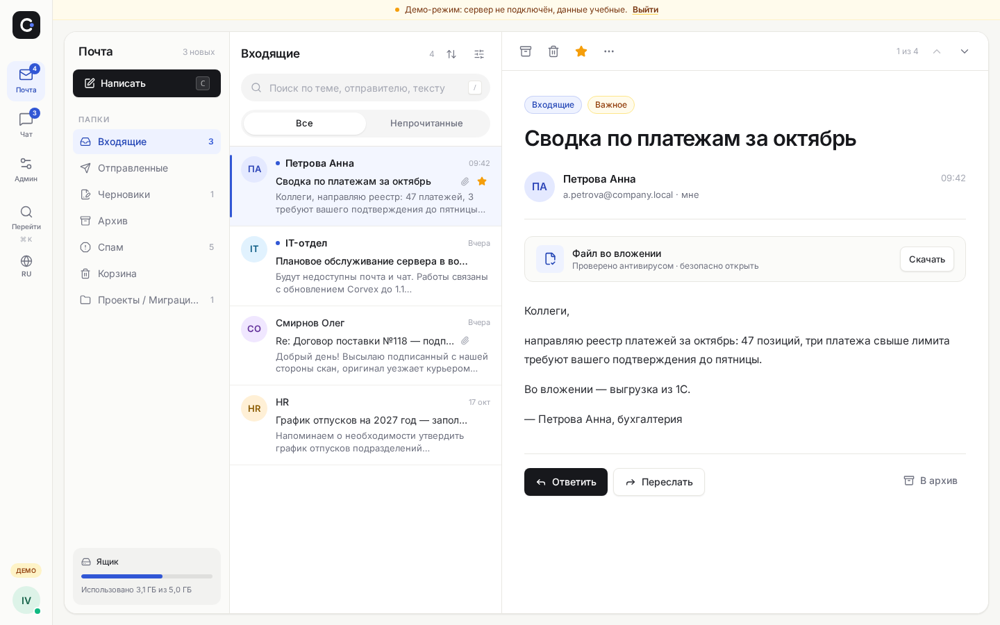
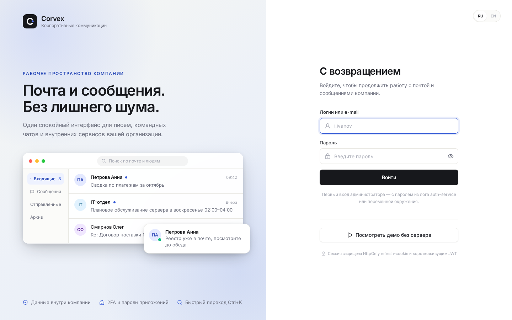
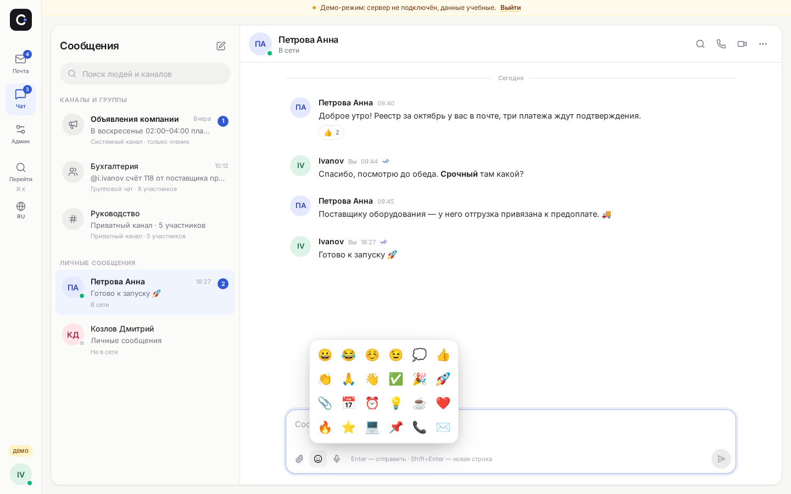
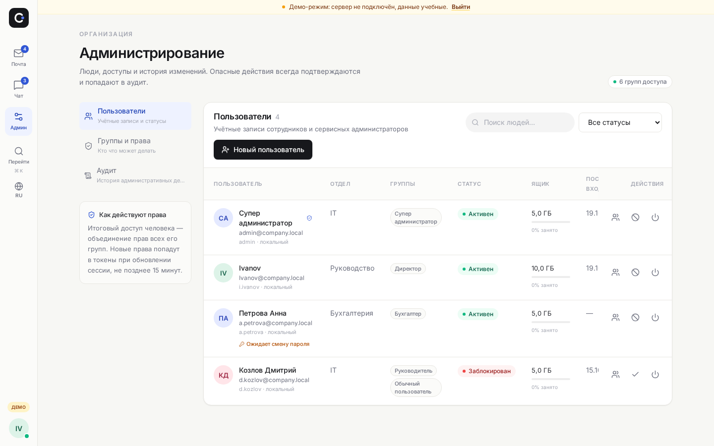
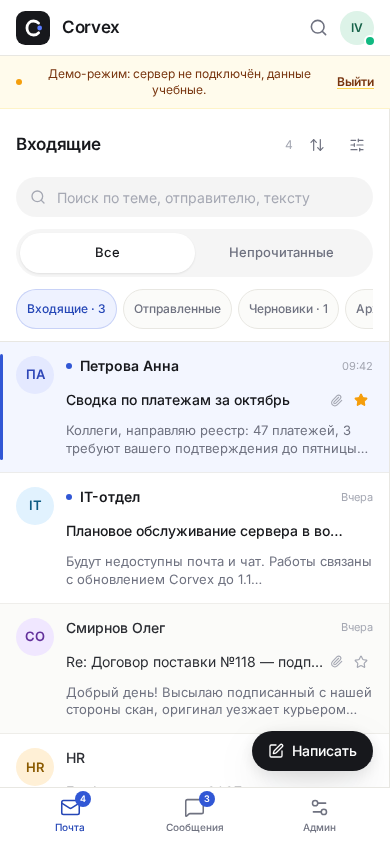

<div align="center">


# Corvex

**Корпоративная почта, чат, календарь и файлы на вашем сервере.**
**Corporate mail, chat, calendar and files that stay home.**

<sub>Свободное ПО (Apache-2.0). 12 Java-сервисов и один React-интерфейс в одном Docker Compose.
Free &amp; open source, Apache-2.0.</sub>

[Русский](#что-это-такое) · [English](README.en.md) · [Статус](docs/STATUS.md) · [Установка](docs/INSTALL.md) · [Требования](docs/SERVER-REQUIREMENTS.md) · [Документация](docs/README.md) · [Участие](CONTRIBUTING.md)

[](LICENSE)
[](docs/STATUS.md)
[](https://t.me/Artem_Dobrokvashin)

[](docs/screenshots/mail-ru.png)

<sub>Реальный скриншот собранного интерфейса с демонстрационными данными. Скриншот показывает
отрисовку, а не проверенную работу сервера: результаты проверок — в [docs/STATUS.md](docs/STATUS.md).</sub>

</div>

## Что это такое

Corvex — self-hosted платформа коммуникаций для организации: собственный почтовый сервер
(SMTP, IMAP, POP3), веб-почта, чат в реальном времени, календарь с напоминаниями, личный
диск и админ-панель с гибкими правами. Всё ставится одним `docker-compose` на сервер
компании; данные, пользователи и аудит остаются внутри, внешнему SaaS ничего не передаётся.

Кому это нужно: организациям, которым важно самим владеть перепиской; тем, у кого часть
парка — Windows 7 и Chrome 109 и их нельзя выбросить; тем, кто не хочет платить за
пользователя и мириться с закрытым кодом.

Проект развивает один разработчик, **Artem Dobrokvashin**. Это не продукт большой
команды: код, архитектура и документация ведутся открыто. Участие — [`CONTRIBUTING.md`](CONTRIBUTING.md).

> [!CAUTION]
> **Corvex пока не production-ready.** Установка, вход, админка, почта, чат, календарь и
> диск написаны и собираются, часть сценариев проверена на тестовом стенде, но полный
> сквозной прогон почты, приёмка почтовых клиентов и восстановление из бэкапа ещё не
> закрыты. Это стенд для разработки и приёмки, а не замена рабочей почте: не направляйте
> production MX и не переносите рабочие ящики. Что именно проверено — [`docs/STATUS.md`](docs/STATUS.md).

## Возможности

- **Почта.** Durable SMTP-приём, конвейер SpamAssassin → ClamAV → хранилище, Maildir и
  дедупликация вложений по SHA-256, DKIM, исходящая очередь с повторами и DSN,
  submission 587 с AUTH и STARTTLS, IMAP и POP3 на Apache James.
- **Веб-почта.** Папки, список и чтение писем, вложения, отправка, черновики, подпись,
  поиск, групповые действия и пересылка с вложениями, HTML-письма с запретом внешних
  изображений до явного разрешения, RU/EN.
- **Внешние ящики.** Старые адреса Mail.ru, Яндекса, Gmail, Outlook или свой сервер
  подключаются по IMAP/POP3: сбор новых писем, импорт архива, дедупликация, отправка от
  имени внешнего адреса.
- **Чат.** Комнаты и личные диалоги, история в PostgreSQL, STOMP поверх RabbitMQ,
  реакции, закрепления, прочтения, упоминания, поиск, файлы с проверкой антивирусом.
- **Календарь.** События с часовым поясом, повторения, участники, серверные напоминания
  письмом — приходят при закрытом браузере и переживают перезапуск.
- **Файлы.** Личный диск: папки, поиск, корзина, перемещение и ссылки по модели Google
  Drive — файл приватный по умолчанию, ссылка выдаётся явно и отзывается мгновенно.
- **Администрирование.** Пользователи, квоты, 6 системных и пользовательские группы,
  25 атомарных прав (права групп суммируются), аудит, health, аналитика, защита последнего
  суперадминистратора.
- **Безопасность.** Argon2id, lockout, JWT RS256 на 15 минут, вращающиеся refresh-сессии
  в HttpOnly `SameSite=Strict` cookie, TOTP, пароли приложений, внутренние API с секретом
  и fail-closed.
- **Эксплуатация.** Prometheus, Grafana, Loki, Alertmanager и независимый `alert-relay`
  для внешнего SMTP/Telegram/MAX, если внутренняя почта недоступна; скрипты бэкапа,
  восстановления и приёмки.
- **Старый парк.** Modern-бандл для актуальных браузеров и legacy-бандл для Chrome 109,
  адаптивная вёрстка от 320 px, полностью RU/EN.

## Требования

Один сервер (физический или ВМ): **4–6 vCPU, 16 ГБ RAM, 200 ГБ SSD** (100 ГБ система +
100 ГБ данные) и отдельный носитель 100–200 ГБ под резервные копии — расчёт на 50 ящиков.
Нужны публичный IP, порт 25 в обе стороны и возможность поставить PTR. Платных лицензий
нет, сертификат Let's Encrypt бесплатный.

Полные требования — сеть, порты, DNS, сертификат, доступы, формула под другое число
ящиков: [`docs/SERVER-REQUIREMENTS.md`](docs/SERVER-REQUIREMENTS.md).

## Быстрый старт

**Посмотреть интерфейс без сервера** — нужен только Node.js (`^22.22.2 || ^24.15.0 || >=26`):

```bash
git clone https://github.com/ArtemDobrokvashin/Corvex-.git
cd Corvex-/frontend
npm ci
npm run dev
```

Откройте `http://localhost:5173` и нажмите «Посмотреть демо без сервера». Почта, чат и
админка откроются на учебных данных с жёлтой плашкой. Это демонстрация интерфейса, а не
работающий сервер.

**Полный стек** — нужны Docker и Docker Compose:

```powershell
git clone https://github.com/ArtemDobrokvashin/Corvex-.git C:\Corvex
cd C:\Corvex

.\scripts\first-run.ps1          # .env, JWT-ключ, пилотный сертификат
notepad .env                     # домен, почтовый домен, получатели алертов

docker compose up -d --build
docker compose ps                # сервисы healthy
```

Интерфейс откроется на `https://mail.<ваш-домен>`. Первый пользователь — `admin`, пароль
задаётся в `.env` или один раз печатается в лог:
`docker compose logs auth-service | Select-String BOOTSTRAP`.

Пошаговая инструкция с Hyper-V, брандмауэром, TLS, DNS и первым запуском:
[`docs/INSTALL.md`](docs/INSTALL.md) · [English](docs/INSTALL.en.md).

## Скриншоты

| | |
|---|---|
| [](docs/screenshots/login-ru.png)<br><sub>Вход, RU/EN</sub> | [](docs/screenshots/chat-ru.png)<br><sub>Чат, реакции</sub> |
| [](docs/screenshots/admin-ru.png)<br><sub>Администрирование</sub> | [](docs/screenshots/mail-mobile-ru.png)<br><sub>Мобильная почта</sub> |

Кадры — реальные скриншоты собранного фронтенда. Пересъёмка одной командой (нужен
установленный Chrome или Edge): `.\scripts\capture-screenshots.ps1`. Правила и матрица
кадров: [`docs/screenshots/README.md`](docs/screenshots/README.md).

## Документация

| Документ | О чём |
|---|---|
| [docs/README.md](docs/README.md) | карта документации: что открыть под какую задачу |
| [docs/SERVER-REQUIREMENTS.md](docs/SERVER-REQUIREMENTS.md) | требования к серверу, сети, DNS и доступам |
| [docs/INSTALL.md](docs/INSTALL.md) | установка и первый запуск (есть [English](docs/INSTALL.en.md)) |
| [docs/ARCHITECTURE.md](docs/ARCHITECTURE.md) | устройство системы, сервисы, данные, Docker, фронтенд |
| [docs/API.md](docs/API.md) | REST, STOMP и события RabbitMQ; OpenAPI — в [docs/api/](docs/api/) |
| [docs/MAIL.md](docs/MAIL.md) | почтовый контур: SMTP, IMAP, POP3, James, внешние ящики |
| [docs/USER-GUIDE.md](docs/USER-GUIDE.md) | как пользоваться почтой, чатом, календарём и файлами |
| [docs/ADMIN-GUIDE.md](docs/ADMIN-GUIDE.md) | админка, права, квоты, настройки, алерты |
| [docs/OPERATIONS.md](docs/OPERATIONS.md) | бэкап, мониторинг, обновления, сбои, перенос на сервер |
| [docs/TESTING.md](docs/TESTING.md) | как проверить систему самому: тесты и чек-лист приёмки |
| [docs/STATUS.md](docs/STATUS.md) | что проверено фактически, а что нет |
| [docs/ROADMAP.md](docs/ROADMAP.md) | что дальше и в каком порядке |
| [docs/DEPENDENCIES.md](docs/DEPENDENCIES.md) | версии зависимостей и политика обновлений |
| [docs/DESIGN.md](docs/DESIGN.md) | визуальный язык интерфейса |
| [CONTRIBUTING.md](CONTRIBUTING.md) | как участвовать: код, тесты, документация, переводы |
| [SECURITY.md](SECURITY.md) | как сообщить об уязвимости |
| [SUPPORT.md](SUPPORT.md) | куда писать о проблемах и предложениях |
| [ADOPTERS.md](ADOPTERS.md) | кто использует Corvex и как добавить организацию |

## Безопасность и приватность

- Refresh-токен хранится как SHA-256 от 32 случайных байт, а не в открытом виде.
- Внутренние API не маршрутизируются наружу и требуют отдельного секрета; без него —
  fail-closed `503`.
- nginx — единственный доверенный edge для клиентского IP: поддельный `X-Forwarded-For`
  не попадает в rate-limit и аудит.
- Секреты внешних ящиков и каналов алертов хранятся в AES-256-GCM и не возвращаются API.
- Markdown санитизируется; внешние изображения в письмах и чате по умолчанию заблокированы.
- Скрытой телеметрии, рекламных трекеров и license phone-home нет.

Уязвимости: [`SECURITY.md`](SECURITY.md). Аудит и остаточные находки — в
[`docs/STATUS.md`](docs/STATUS.md).

## Участие и поддержка

Нужны код, тесты, проверка на своём стенде и почтовых клиентах, документация и переводы.
Правила и требования к PR — [`CONTRIBUTING.md`](CONTRIBUTING.md); первый полный прогон
описан в [`docs/TESTING.md`](docs/TESTING.md). Для сообщения об ошибке достаточно SHA
коммита, версий инструментов, выполненных команд и первой ошибки.

Не прикладывайте `.env`, пароли, ключи и настоящие письма. Проверяйте на отдельной ВМ и
тестовом домене.

Автор: **Artem Dobrokvashin** — [Telegram](https://t.me/Artem_Dobrokvashin). Вопросы
проекта, внедрений, миграций и обучения администраторов обсуждаются напрямую.

## Лицензия

Apache License 2.0 — полный текст в [`LICENSE`](LICENSE), атрибуция и сторонние
компоненты в [`NOTICE`](NOTICE). Развёртывание на своём сервере бесплатно, без подписки и
платы за пользователя. Вклад принимается под той же лицензией.
