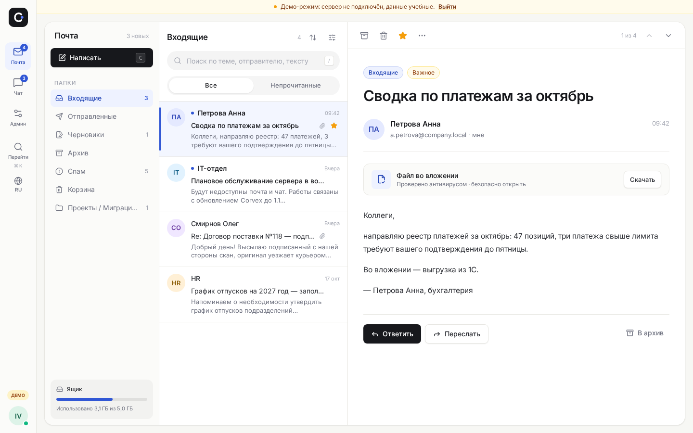
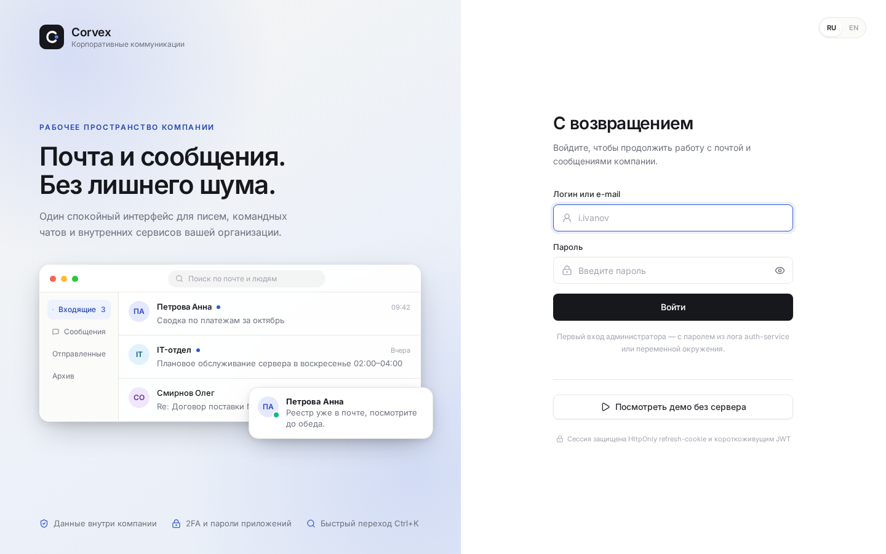
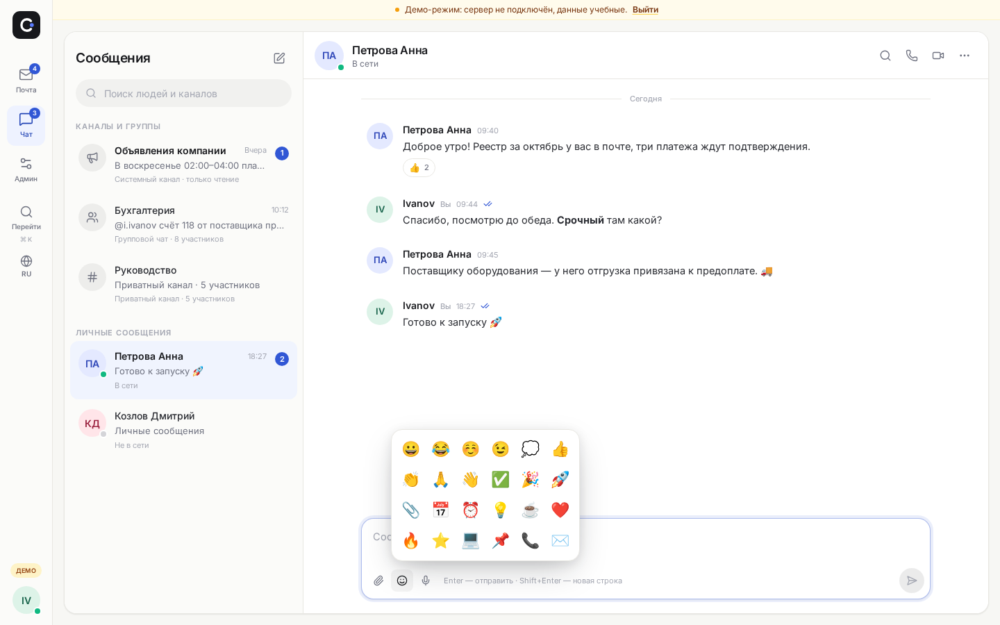
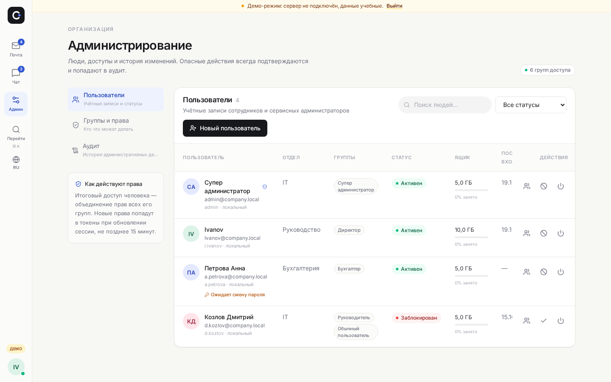
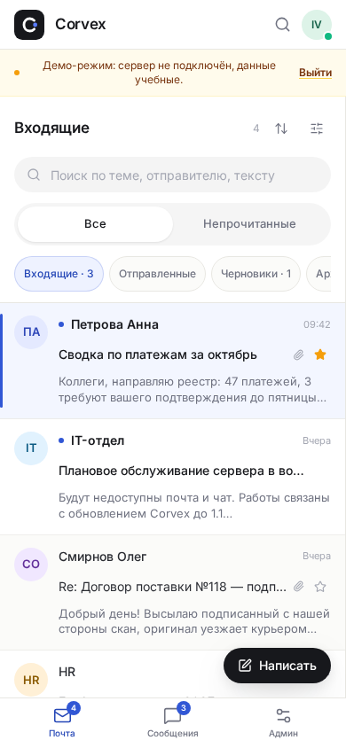
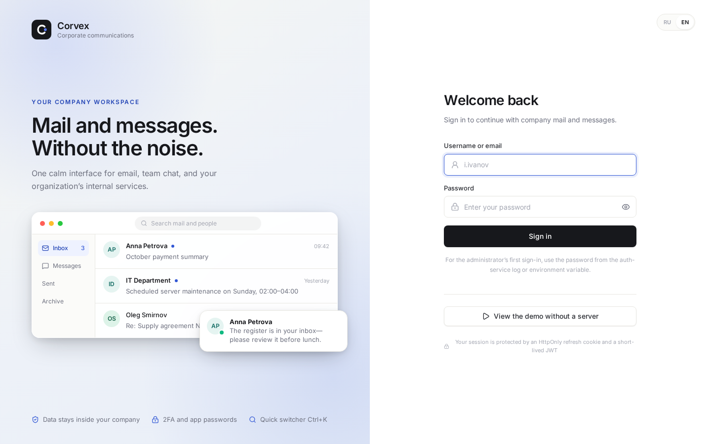
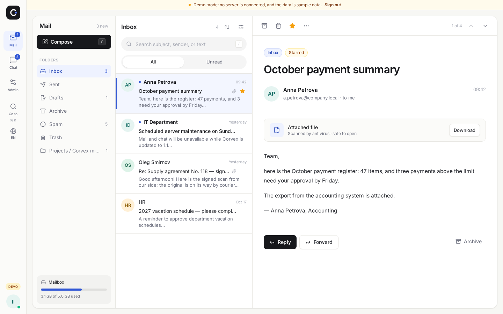
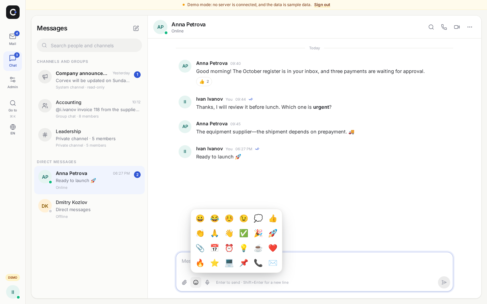
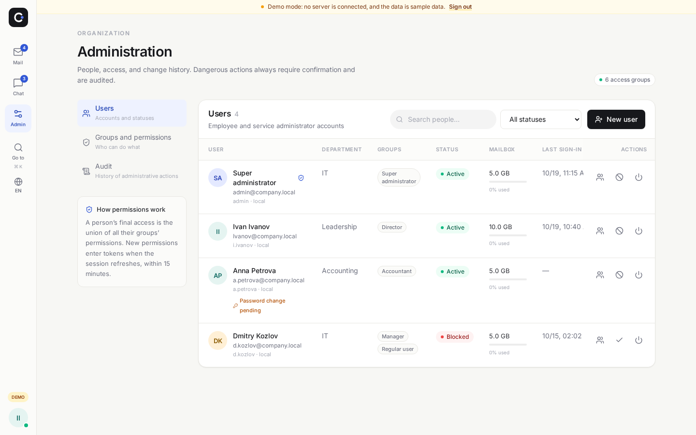

<div align="center">


# Corvex

**Corporate mail & team chat that stays on your server.**<br />
**Корпоративная почта и сообщения, которые остаются дома.**

[Русский](#русский) · [English](#english) · [Screenshots](#скриншоты) · [Quick start](#попробовать-за-2-минуты) · [Install](#установка-на-windows-server) · [Docs](#документация) · [Support Corvex](#поддержать-corvex)

[](https://github.com/ArtemDobrokvashin/Corvex-/stargazers)
[](https://github.com/ArtemDobrokvashin/Corvex-/commits)


[](https://t.me/Artem_Dobrokvashin)

[](docs/screenshots/mail-ru.png)

<sub>Real production-build screenshot. Mail is shown with clearly labelled demo data; identity and administration already run on real APIs.</sub>

</div>

> ⭐ **If Corvex is useful to you, star the repository and tell the author you deployed it.** Corvex has no hidden telemetry and does not phone home — voluntary stars, feedback, and [`ADOPTERS.md`](ADOPTERS.md) entries are how real usage becomes visible.

---

## Русский

### Почта и команды — на вашем сервере, а не в чужом облаке

**Corvex** — self-hosted платформа корпоративных коммуникаций для организаций до 1000 сотрудников: собственный почтовый сервер, современный веб-клиент, командный чат, гибкая админ-панель, 2FA, мониторинг и резервное копирование в одном Docker-развёртывании.

Главное обещание простое: **переписка компании должна принадлежать компании**. Без обязательной аренды внешнего облака, без платы за пользователя на текущем этапе и без зависимости от того, доступен ли чужой SaaS сегодня утром.

| Типичная боль | Как отвечает Corvex |
|---|---|
| Почта и чаты живут у внешнего провайдера | Данные, пользователи и аудит остаются на сервере организации |
| Старый парк Windows 7 / Chrome 109 нельзя просто выбросить | Отдельный legacy-бандл и адаптивный интерфейс для ПК, планшетов и телефонов |
| Админка либо «всё можно», либо «ничего нельзя» | 6 групп и 24 атомарных права-чекбокса; права суммируются по группам |
| Интерфейс переведён наполовину, ошибки API — на другом языке | Полные RU/EN: интерфейс, даты, числа, demo-данные и публичные ошибки API |
| Проект обещает «enterprise-ready», но прячет ограничения | Открытый аудит, честные ворота готовности и SMTP, выключенный до durable-доставки |

> [!IMPORTANT]
> **Статус сегодня:** Stage 1 — настоящий вход, пользователи, RBAC и админка. Боевая доставка почты — Stage 2, IMAP/POP3 — Stage 3, сохраняемый чат — Stage 4. Не направляйте production MX на Corvex, пока не закрыты ворота в [`docs/READINESS.md`](docs/READINESS.md).

### Попробовать за 2 минуты

Нужен только Node.js:

```bash
git clone -b arena/3732db07-corvex https://github.com/ArtemDobrokvashin/Corvex-.git
cd Corvex-/frontend
npm install
npm run dev
```

Откройте `http://localhost:5173` и нажмите **«Посмотреть демо без сервера»**. Почта и чат покажут учебные данные с жёлтой плашкой; в полном стеке вход и администрирование работают через настоящие API.

Понравилось? Поставьте ⭐ на GitHub и добавьте организацию в [`ADOPTERS.md`](ADOPTERS.md) — скрытой телеметрии в Corvex нет, поэтому автор иначе не увидит ваше внедрение.

### Скриншоты

Все кадры ниже — реальные скриншоты production-сборки в Chromium. Почта и сообщения используют демо-данные до этапов 2 и 4.

<table>
  <tr>
    <td width="50%"><a href="docs/screenshots/login-ru.png"></a><br /><sub>Вход и RU/EN переключатель</sub></td>
    <td width="50%"><a href="docs/screenshots/chat-ru.png"></a><br /><sub>Сообщения, реакции и цветные Unicode-эмодзи</sub></td>
  </tr>
  <tr>
    <td width="50%"><a href="docs/screenshots/admin-ru.png"></a><br /><sub>Пользователи, группы, статусы и квоты</sub></td>
    <td width="50%" align="center"><a href="docs/screenshots/mail-mobile-ru.png"></a><br /><sub>Мобильная почта</sub></td>
  </tr>
</table>

Как воспроизводимо переснять кадры: [`docs/screenshots/README.md`](docs/screenshots/README.md).

### Возможности

#### Уже работает на реальном бэкенде

- **Identity:** Argon2id, lockout после 5 неудач на 15 минут, JWT RS256 на 15 минут, вращающиеся refresh-сессии в HttpOnly `SameSite=Strict` cookie и детект повторного использования refresh-токена.
- **2FA и клиенты:** TOTP setup/confirm/disable, MFA-шаг при входе и пароли приложений для будущих IMAP/SMTP-клиентов.
- **Администрирование:** пользователи, квоты, блокировка/отключение, 6 системных и пользовательские группы, 24 права, аудит, настройки, health и базовая аналитика.
- **Защита от самоблокировки:** последнего `SUPER_ADMIN` нельзя лишить группы, заблокировать или отключить через API.
- **RU/EN до конца:** переключаются интерфейс, demo-данные, системные группы, формат дат/чисел/байт и `ProblemDetail` ошибки auth/admin по `Accept-Language`.
- **Эмодзи без картинок и CDN:** нативный Unicode picker, вставка в курсор, реакции и графемно-безопасная обрезка сложного текста.

#### Запроектировано и строится по этапам

- **Почта:** SubEtha SMTP, Apache James IMAP/POP3, Maildir + SHA-256 CAS, SpamAssassin, ClamAV, Elasticsearch, DKIM/SPF/DMARC.
- **Чат:** STOMP/RabbitMQ, persistent rooms, membership authorization, файлы, presence и push-события.
- **Enterprise:** AD/LDAP, mTLS между сервисами, мгновенный отзыв JWT, расширенный hardening и нагрузочные ворота до 1000 сотрудников.

### Статус и roadmap

| Этап | Содержимое | Статус |
|---|---|---|
| 1 | Identity, пользователи, группы, RBAC, аудит, админка | ✅ код готов; нужен первый Maven/Docker smoke на целевом хосте |
| 2 | Durable SMTP-доставка, storage, spam/AV, поиск, исходящая очередь | 🚧 следующий главный этап |
| 3 | IMAP/POP3 на Apache James, Outlook/Thunderbird | 📐 контракты и порты готовы |
| 4 | Persistent realtime-чат, файлы, presence | 📐 UI и STOMP-каркас готовы |
| 5 | AD/LDAP, mTLS, production hardening | 📐 спроектировано |

SMTP выключен по умолчанию на всех уровнях, пока письмо нельзя гарантированно сохранить. Corvex не должен ответить `250 OK` и потерять сообщение.

### Установка на Windows Server

> Команда ниже выбирает текущую ветку аудита. После слияния в `main` уберите `-b arena/3732db07-corvex`.

```powershell
git clone -b arena/3732db07-corvex https://github.com/ArtemDobrokvashin/Corvex-.git C:\Corvex
cd C:\Corvex

.\scripts\first-run.ps1     # уникальные секреты, JWT-ключ, internal API token, пилотный TLS, .env
notepad .env                # CORVEX_DOMAIN, CORVEX_MAIL_DOMAIN, получатели алертов

docker compose config
docker compose up -d --build                 # 12 микросервисов + инфраструктура
docker compose --profile monitoring up -d    # Prometheus, Grafana, Loki, Alertmanager
docker compose ps                            # первый настоящий smoke-gate: все healthy
```

Откройте `https://mail.<ваш-домен>`. Первый пользователь — `admin`; пароль задаётся `CORVEX_BOOTSTRAP_ADMIN_PASSWORD` или один раз печатается в лог:

```powershell
docker compose logs auth-service | Select-String BOOTSTRAP
```

Полная инструкция: [`docs/INSTALL.md`](docs/INSTALL.md) — Hyper-V/Docker, брандмауэр, TLS, DNS, сертификаты, бэкапы и траблшутинг.

### Архитектура

12 сервисов Java 17 / Spring Boot за единым gateway:

- `auth-service` владеет учётками, паролями, TOTP и сессиями;
- `admin-service` — группами, правами, настройками и аудитом;
- `web-gateway` проверяет JWT и ограничивает частоту запросов;
- `mail-smtp`, `mail-imap`, `mail-pop3` отделяют протоколы от бизнес-логики;
- `mail-storage` — Maildir и вложения по SHA-256 с дедупликацией;
- `mail-spam`, `mail-antivirus` — тонкие клиенты SpamAssassin и ClamAV;
- `chat-service`, `chat-file-service` — STOMP и файлы;
- `notification-service` превращает Alertmanager webhook в email администраторам.

Данные: PostgreSQL 16 (database-per-service), Redis, RabbitMQ, Elasticsearch, Maildir + CAS. Наблюдаемость: Prometheus, Grafana, Loki. Один `docker-compose.yml`: 25 контейнеров, 4 сети, 12 томов.

Диаграммы и ADR: [`docs/01-architecture.md`](docs/01-architecture.md).

### Безопасность и приватность

- Refresh-токен не хранится в открытом виде: в PostgreSQL лежит SHA-256 от 32 случайных байт.
- Внутренние auth/admin API не маршрутизируются наружу и требуют `X-Corvex-Internal-Token`; без секрета — fail-closed `503`.
- nginx — единственный доверенный edge для клиентского IP; поддельный первый `X-Forwarded-For` не попадает в rate-limit и аудит.
- Повторный TOTP setup не заменяет уже включённую 2FA без текущего кода.
- Настройки валидируются на сервере и пишутся одной транзакцией.
- Markdown санитизируется; внешние изображения в чате запрещены как tracking pixels.
- **Нет скрытой телеметрии, рекламных трекеров и license phone-home.** Если когда-нибудь появится проверка обновлений, она должна быть явной, документированной и отключаемой.

Полный аудит: [`docs/12-full-audit-2026-10.md`](docs/12-full-audit-2026-10.md).

### Документация

| Документ | Содержание |
|---|---|
| [`docs/TECHNICAL_DESIGN.md`](docs/TECHNICAL_DESIGN.md) | мастер-документ технического проекта |
| [`docs/12-full-audit-2026-10.md`](docs/12-full-audit-2026-10.md) | полный аудит фронтенда, бэкенда и инфраструктуры |
| [`docs/READINESS.md`](docs/READINESS.md) | честный статус по компонентам и ворота пилота |
| [`docs/INSTALL.md`](docs/INSTALL.md) | установка и эксплуатация; есть [`INSTALL.en.md`](docs/INSTALL.en.md) |
| [`docs/11-modern-design-analysis.md`](docs/11-modern-design-analysis.md) | Gmail/Outlook/Slack/Superhuman/Linear и дизайн-система Quiet Work |
| [`docs/api/*.yaml`](docs/api/) | OpenAPI: auth, mail, chat, admin |
| [`ADOPTERS.md`](ADOPTERS.md) | кто использует Corvex и как добавить организацию |
| [`SUPPORT.md`](SUPPORT.md) | куда писать о багах, безопасности, донатах и коммерческой помощи |

### Поддержать Corvex

Corvex развивается как авторский проект. Сейчас он **бесплатен для self-hosted развёртывания**, но разработка, тесты и поддержка стоят времени. Есть четыре способа помочь проекту выстрелить:

1. **⭐ Поставьте звезду на GitHub.** Это главный публичный сигнал, что проект нужен.
2. **Расскажите о внедрении.** Добавьте организацию в [`ADOPTERS.md`](ADOPTERS.md) или напишите автору приватно. Без телеметрии это единственный способ увидеть реальные установки.
3. **Поддержите деньгами.** Добровольный донат можно согласовать напрямую с автором: **Artem Dobrokvashin — [https://t.me/Artem_Dobrokvashin](https://t.me/Artem_Dobrokvashin)**. Реквизиты в репозитории не публикуются.
4. **Закажите помощь.** Можно обсудить внедрение, планирование миграции, обучение администраторов, приоритетные исправления и заказные интеграции.

Планируемая устойчивая модель — не брать базовую почту в заложники: ядро для собственного сервера остаётся бесплатным на текущем этапе, а доход должны давать добровольная поддержка, услуги внедрения/сопровождения и, в будущем, отдельные enterprise-добавки и priority support. Если появится платная редакция, её условия будут опубликованы отдельно и честно.

### Лицензия

На текущем этапе автор предоставляет Corvex **бесплатно** для развёртывания на собственном сервере: без подписки и без платы за пользователя. Отдельный юридический текст лицензии будет добавлен перед публичным релизом; если организации нужны письменные условия уже сейчас, свяжитесь с автором до внедрения.

---

## English

### Mail and team conversations that stay home

**Corvex** is a self-hosted corporate communication platform for organizations of up to 1,000 employees: an own mail server, a modern webmail client, team chat, a flexible administration panel, 2FA, monitoring, and backups in one Docker deployment.

The promise is deliberately simple: **a company's correspondence should belong to the company**. No mandatory external cloud, no per-seat rent at the current stage, and no morning outage caused by somebody else's SaaS.

| Common pain | Corvex answer |
|---|---|
| Mail and chat live with an external provider | Data, users, and audit stay on your organization's server |
| The Windows 7 / Chrome 109 fleet cannot simply be discarded | A dedicated legacy bundle plus responsive phone/tablet layouts |
| Administration is either “everything” or “nothing” | 6 groups and 24 atomic checkbox permissions, unioned across groups |
| Half the UI is translated and API errors are not | Complete RU/EN across UI, dates, numbers, demo data, and public API errors |
| “Enterprise-ready” hides the fine print | A public audit, explicit readiness gates, and SMTP disabled until durable delivery |

> [!IMPORTANT]
> **Current status:** Stage 1 provides real sign-in, users, RBAC, and administration. Production mail delivery is Stage 2, IMAP/POP3 is Stage 3, and persistent chat is Stage 4. Do not point production MX records at Corvex until the gates in [`docs/READINESS.md`](docs/READINESS.md) pass.

### Try it in 2 minutes

Only Node.js is required:

```bash
git clone -b arena/3732db07-corvex https://github.com/ArtemDobrokvashin/Corvex-.git
cd Corvex-/frontend
npm install
npm run dev
```

Open `http://localhost:5173` and click **“View the demo without a server.”** Mail and Messages show clearly labelled sample data; in the full stack, sign-in and Administration use real APIs.

Like what you see? Star the repository and add your organization to [`ADOPTERS.md`](ADOPTERS.md). Corvex contains no hidden telemetry, so the author cannot otherwise see your deployment.

### Screenshots

All frames below are real captures of the production frontend build in Chromium. Mail and Messages use demo data until Stages 2 and 4.

<table>
  <tr>
    <td width="50%"><a href="docs/screenshots/login-en.png"></a><br /><sub>Sign-in with the RU/EN switch</sub></td>
    <td width="50%"><a href="docs/screenshots/mail-en.png"></a><br /><sub>Mail in the Quiet Work three-pane layout</sub></td>
  </tr>
  <tr>
    <td width="50%"><a href="docs/screenshots/chat-en.png"></a><br /><sub>Messages, reactions, and native color emoji</sub></td>
    <td width="50%"><a href="docs/screenshots/admin-en.png"></a><br /><sub>Users, groups, statuses, and quotas</sub></td>
  </tr>
</table>

Reproduce the captures with [`docs/screenshots/README.md`](docs/screenshots/README.md).

### Features

#### Working on the real backend today

- **Identity:** Argon2id, 15-minute lockout after 5 failures, 15-minute RS256 JWTs, rotating refresh sessions in an HttpOnly `SameSite=Strict` cookie, and refresh-token reuse detection.
- **2FA and clients:** TOTP setup/confirm/disable, an MFA sign-in step, and app passwords for future IMAP/SMTP clients.
- **Administration:** users, quotas, block/disable, 6 system plus custom groups, 24 permissions, audit, settings, service health, and basic sign-in analytics.
- **No accidental lock-out:** the last `SUPER_ADMIN` cannot lose membership, be blocked, or be disabled through the API.
- **RU/EN end to end:** UI, demo data, system groups, dates/numbers/bytes, and auth/admin `ProblemDetail` errors localized by `Accept-Language`.
- **Emoji without images or a CDN:** a native Unicode picker, cursor-aware insertion, reactions, and grapheme-safe text handling.

#### Designed and being built in stages

- **Mail:** SubEtha SMTP, Apache James IMAP/POP3, Maildir + SHA-256 CAS, SpamAssassin, ClamAV, Elasticsearch, DKIM/SPF/DMARC.
- **Chat:** STOMP/RabbitMQ, persistent rooms, membership authorization, files, presence, and push events.
- **Enterprise:** AD/LDAP, service-to-service mTLS, instant JWT revocation, hardening, and load gates for 1,000 employees.

### Status and roadmap

| Stage | Scope | Status |
|---|---|---|
| 1 | Identity, users, groups, RBAC, audit, administration | ✅ code complete; needs the first Maven/Docker smoke on a target host |
| 2 | Durable SMTP delivery, storage, spam/AV, search, outbound queue | 🚧 next major stage |
| 3 | Apache James IMAP/POP3, Outlook/Thunderbird | 📐 contracts and ports ready |
| 4 | Persistent realtime chat, files, presence | 📐 UI and STOMP skeleton ready |
| 5 | AD/LDAP, mTLS, production hardening | 📐 designed |

SMTP is disabled by default at every layer until a message can be stored durably. Corvex must never say `250 OK` and lose mail.

### Install on Windows Server

> The command below selects the current audit branch. After it is merged into `main`, drop `-b arena/3732db07-corvex`.

```powershell
git clone -b arena/3732db07-corvex https://github.com/ArtemDobrokvashin/Corvex-.git C:\Corvex
cd C:\Corvex

.\scripts\first-run.ps1     # unique secrets, JWT key, internal API token, pilot TLS, .env
notepad .env                # CORVEX_DOMAIN, CORVEX_MAIL_DOMAIN, alert recipients

docker compose config
docker compose up -d --build                 # 12 microservices + infrastructure
docker compose --profile monitoring up -d    # Prometheus, Grafana, Loki, Alertmanager
docker compose ps                            # first real smoke gate: everything healthy
```

Open `https://mail.<your-domain>`. The first user is `admin`; set `CORVEX_BOOTSTRAP_ADMIN_PASSWORD` or read the one-time password from the log:

```powershell
docker compose logs auth-service | Select-String BOOTSTRAP
```

Complete guide: [`docs/INSTALL.en.md`](docs/INSTALL.en.md).

### Architecture

Twelve Java 17 / Spring Boot services sit behind one gateway. Auth owns accounts, passwords, TOTP, and sessions; Admin owns groups, permissions, settings, and audit; Gateway verifies JWTs and rate limits. Mail protocols are separated from Maildir/SHA-256 storage, spam uses SpamAssassin, antivirus uses ClamAV, chat uses STOMP/RabbitMQ, and notifications turn Alertmanager webhooks into administrator email.

Data lives in PostgreSQL 16 (database-per-service), Redis, RabbitMQ, Elasticsearch, and Maildir + CAS. Observability uses Prometheus, Grafana, and Loki. One `docker-compose.yml` defines 25 containers, 4 networks, and 12 volumes.

Diagrams and ADRs: [`docs/01-architecture.md`](docs/01-architecture.md).

### Security and privacy

- Refresh tokens are never stored raw: PostgreSQL keeps SHA-256 of 32 random bytes.
- Internal auth/admin APIs are not routed by the gateway and require `X-Corvex-Internal-Token`; with no secret they fail closed with `503`.
- nginx is the only trusted edge for client IP; a spoofed first `X-Forwarded-For` cannot poison rate limits or audit.
- Re-running TOTP setup cannot replace already enabled 2FA without a current code.
- Admin settings are validated on the server and written in one transaction.
- Chat Markdown is sanitized and external images are forbidden as tracking pixels.
- **No hidden telemetry, advertising trackers, or license phone-home.** Any future update check must be explicit, documented, and disableable.

Full audit: [`docs/12-full-audit-2026-10.md`](docs/12-full-audit-2026-10.md).

### Documentation

| Document | Contents |
|---|---|
| [`docs/TECHNICAL_DESIGN.md`](docs/TECHNICAL_DESIGN.md) | master technical design |
| [`docs/12-full-audit-2026-10.md`](docs/12-full-audit-2026-10.md) | full frontend/backend/infrastructure audit |
| [`docs/READINESS.md`](docs/READINESS.md) | honest component status and pilot gates |
| [`docs/INSTALL.en.md`](docs/INSTALL.en.md) | installation and operations; Russian: [`INSTALL.md`](docs/INSTALL.md) |
| [`docs/api/*.yaml`](docs/api/) | OpenAPI: auth, mail, chat, admin |
| [`ADOPTERS.md`](ADOPTERS.md) | who uses Corvex and how to add an organization |
| [`SUPPORT.md`](SUPPORT.md) | bugs, security reports, donations, and commercial help |

### Support Corvex

Corvex is an author-led project. It is currently **free for self-hosted deployment**, but development, testing, and support take real time. Four actions make a disproportionate difference:

1. **⭐ Star the repository.** Stars are the main public signal that the project should exist.
2. **Tell the author you deployed it.** Add your organization to [`ADOPTERS.md`](ADOPTERS.md) or send a private note. With no telemetry, this is the only way real installations become visible.
3. **Donate.** Arrange voluntary support directly with the author: **Artem Dobrokvashin — [https://t.me/Artem_Dobrokvashin](https://t.me/Artem_Dobrokvashin)**. Payment details are intentionally not published here.
4. **Buy help.** Discuss deployment assistance, migration planning, administrator training, priority fixes, or custom integrations.

The intended sustainable model is not to hold basic mail hostage: keep the self-hosted core free at the current stage, and earn from voluntary support, services, maintenance, and possible future enterprise add-ons/priority support. If a paid edition appears, its terms will be published separately and plainly.

### License

At the current stage, the author provides Corvex **free of charge** for self-hosted deployment: no subscription and no per-user fee. A standalone legal license text will be added before a public release; if your organization needs written terms now, contact the author before adoption.
