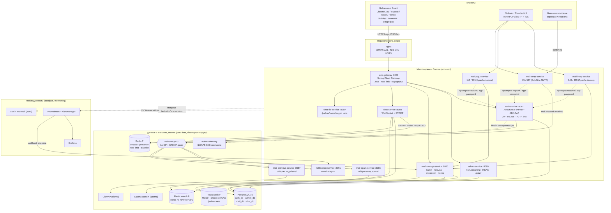
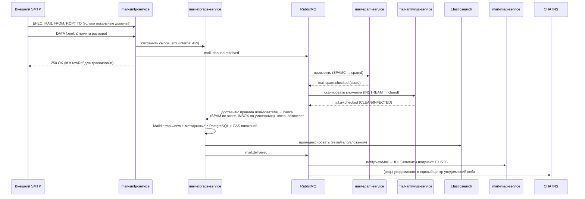
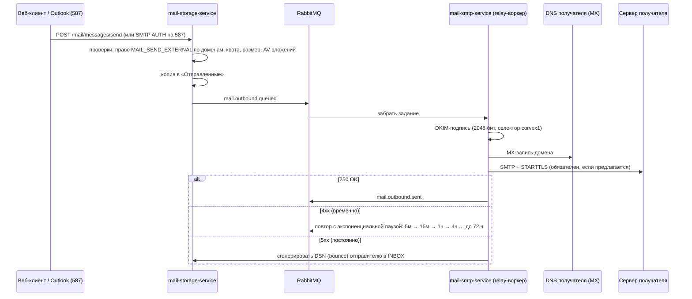
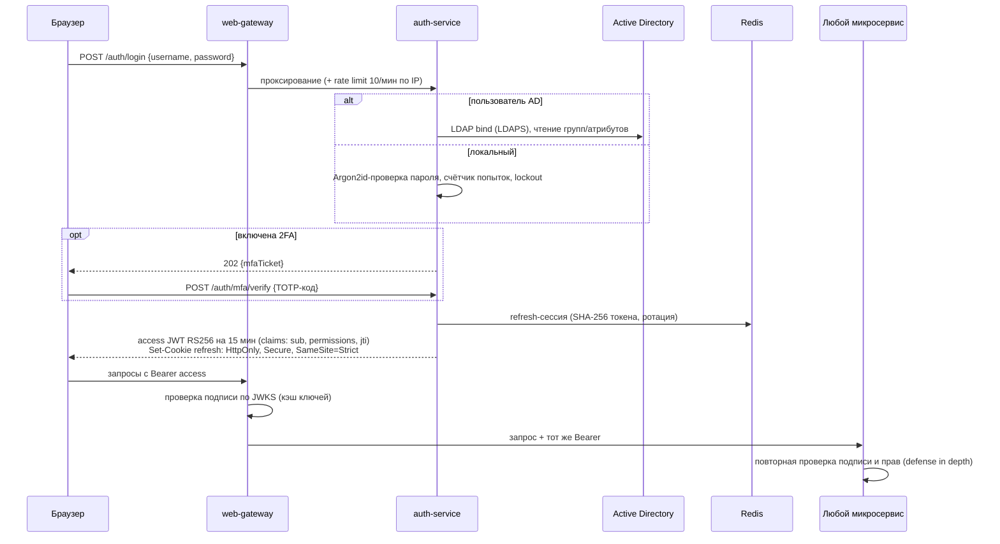

# 1. Детальная диаграмма архитектуры

> К пункту 1 формата вывода ТЗ. Зафиксированные выборы там, где ТЗ допускало «или»,
> вынесены в таблицу ADR в конце файла — каждый выбор обоснован именно для масштаба
> «один сервер, до 1000 сотрудников, Windows-хост».

## 1.1. Системная диаграмма (C4, уровень контейнеров)

## 1.2. Конвейер входящего письма (самая ответственная цепочка)

Принцип: SMTP-сессия короткая, вся дорогая работа — асинхронная; письмо не теряется
при падении любого звена после ответа `250 OK` (сырой .eml уже записан, события — в
надёжных очередях RabbitMQ с DLQ).

Режимы отказа в конвейере (зафиксированы в коде клиентов):

| Звено | При недоступности | Обоснование |
|---|---|---|
| SpamAssassin | **fail-open**: доставка в INBOX, `spam_score=NULL`, заголовок `X-Corvex-Spam-Checked: no`, алерт | потеря деловой почты хуже, чем лишний спам на время восстановления |
| ClamAV | **fail-closed по вложению**: письмо доставляется, вложение заблокировано (`AV_STATUS=ERROR`), повторная проверка фоновой задачей | инфицированный файл недопустим, но и письмо терять не нужно |
| Elasticsearch | доставка не блокируется, индексация — повтор из очереди; поиск временно отстаёт | индекс — производные данные, перестраивается из БД |
| PostgreSQL | SMTP отвечает внешнему серверу `451` (временная ошибка) **до** записи сырого письма | отправитель сам повторит доставку позже — стандартное поведение SMTP |

## 1.3. Исходящая почта и доставляемость

Доставляемость обеспечивается не кодом, а инфраструктурой — чек-лист в инструкции по
развёртыванию ([08-deployment-windows-server.md](08-deployment-windows-server.md), шаг 7):
публичный статический IP без «серых» NAT, PTR/rDNS = `mail.<домен>`, SPF `-all` после
пилота, DKIM-подпись, DMARC `p=none` → `quarantine` → `reject` по мере накопления
отчётов, исходящий 25 порт, разблокированный провайдером.

## 1.4. Аутентификация (веб и почтовые протоколы — одна identity)

Для Outlook/Thunderbird: IMAP/SMTP аутентификация ходит в internal API auth-service;
при включённой 2FA пользователь создаёт **пароль приложения** (app-password) в вебе —
основной пароль с TOTP в почтовых протоколах неприменим физически.

## 1.5. Чат реального времени

STOMP поверх WebSocket (SockJS-fallback для старых прокси), брокер-реле — RabbitMQ
STOMP plugin: второй экземпляр chat-service добавляется без потери сообщений между
нодами. Присутствие (`online/away/dnd/offline`), «печатает…» и счётчики непрочитанных —
Redis с TTL; история и поиск — PostgreSQL + Elasticsearch. Детали адресации — в
[03-api-contracts.md](03-api-contracts.md#websocketstomp).

## 1.6. Сетевая изоляция и порты

| Порт наружу | Назначение | Кто слушает |
|---|---|---|
| 443/tcp | веб-интерфейс, API, WSS | nginx → gateway/frontend |
| 80/tcp | редирект на HTTPS + ACME challenge | nginx |
| 25/tcp | приём почты от внешних серверов | mail-smtp-service |
| 587/tcp | отправка своими клиентами (SMTP AUTH + STARTTLS обязательны) | mail-smtp-service |
| 993 / 143 | IMAPS / IMAP+STARTTLS | mail-imap-service |
| 995 / 110 | POP3S / POP3+STLS | mail-pop3-service |

PostgreSQL, Redis, RabbitMQ, Elasticsearch — сеть `data` с `internal: true`, порты
на хост не публикуются вообще. Grafana доступна только через nginx с allowlist подсети
администраторов. Внутри контейнеров сервисы работают от non-root и на
непривилегированных портах (25→2525 и т.п.), проброс делает Docker.

## 1.7. Архитектурные решения (ADR) — выбор из альтернатив ТЗ

| # | Вопрос | Решение | Почему |
|---|---|---|---|
| ADR-01 | RabbitMQ или Kafka | **RabbitMQ** | 1000 пользователей ≈ единицы писем/сек в пике; нужны routing, DLQ, подтверждения и STOMP-реле чата из одного брокера. Kafka оправдана при потоковой аналитике, которой в ТЗ нет, а операционно тяжелее на одном сервере |
| ADR-02 | ELK или Loki для логов | **Loki + Grafana**, ES — только для поиска | второй тяжёлый ES-кластер ради логов на 16–32 ГБ RAM не помещается рядом с поисковым; Loki индексирует только метки |
| ADR-03 | Почтовые протоколы | **SubEtha SMTP** (SMTP), **Apache James protocol libs** (IMAP/POP3) за портами-адаптерами | ТЗ прямо запрещает писать RFC-парсеры с нуля; порты (`ImapServerPort`) позволяют заменить движок без переписывания хранилища |
| ADR-04 | Хранение писем | Maildir (.eml) + метаданные PostgreSQL + CAS вложений по SHA-256 | Maildir = атомарность и бесплатная совместимость с инструментами миграции/восстановления; CAS даёт дедупликацию вложений между ящиками |
| ADR-05 | Состояние фронтенда | **Zustand** | меньше бандл и бойлерплейта, чем Redux Toolkit; при 3 модулях приложения этого достаточно, серверный кэш не дублируем в сторе |
| ADR-06 | JWT | RS256, access 15 мин + вращающийся opaque refresh в HttpOnly cookie | сервисы валидируют токены локально по JWKS без сетевых вызовов; цена — отзыв прав в пределах 15 мин (документируется админу) |
| ADR-07 | Docker на Windows Server | Прод: **Linux-VM в Hyper-V**; пилот допустим на Docker Desktop | Docker Desktop официально не поддерживается на Windows Server и требует платной подписки для крупных компаний; Linux-контейнеры на «голом» Windows Server продакшен-пути не имеют. Подробно — docs/08, шаг 2 |
| ADR-08 | Миграции БД | **Flyway**, SQL-миграции в каждом сервисе | SQL прозрачнее для DBA-ревью, чем Liquibase XML; одна БД — один владелец-сервис |
| ADR-09 | Стили фронтенда | Tailwind CSS 3 + Autoprefixer (targets Chrome ≥109) | Tailwind 4 требует современных CSS-возможностей; третья версия стабильно работает с legacy-сборкой |
| ADR-10 | Масштабирование | вертикальное + реплики stateless-сервисов за gateway | целевая нагрузка (1000 одновременных) закрывается одним сервером рекомендуемой конфигурации; горизонтальный рост заложен в stateless-дизайн и внешний STOMP-брокер, но Kubernetes сознательно вне скоупа |

## 1.8. Расчёт нагрузки (обоснование нефункциональных требований §11.2)

- 1000 сотрудников, ~40 писем/чел/день → 40 000 писем/день, пик ≈ 5 писем/сек —
  конвейер spam→AV→доставка проходит на одном воркере каждого типа с запасом ×10.
- Чат: 1000 одновременных WS-соединений — один экземпляр chat-service (STOMP-реле
  выносит рассылку в RabbitMQ); 500 сообщений/мин в пике — тривиально для PostgreSQL.
- Хранилище: 1000 ящиков × 5 ГБ квоты = 5 ТБ логически; реальное заполнение за первый
  год ≈ 15–25% квот + дедупликация вложений (типично −20–30%) → том 1 ТБ из
  рекомендуемой конфигурации покрывает 1,5–2 года с контролем квот админом.
- Поиск < 1 с: индекс ES по метаданным и телам (без бинарных вложений, текст вложений
  извлекается Tika-подобным экстрактором на этапе индексации), один шард на индекс
  помесячно — при объёмах выше пятилетний горизонт не нужен.
