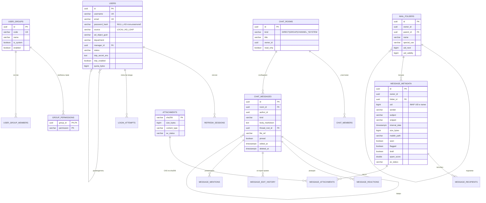

# 4. Схема базы данных

> К пункту 4 формата вывода. Источник истины — Flyway-миграции в сервисах
> (`services/*/src/main/resources/db/migration`), этот документ объясняет модель.

## 4.1. Принципы

- **Database-per-service**: `auth_db`, `admin_db`, `mail_db`, `chat_db` в одном
  экземпляре PostgreSQL 16 (экономия ресурсов одного сервера), но с жёстким запретом
  кросс-БД JOIN и FK: чужие идентификаторы (например, `user_id` в admin_db) — логические
  ссылки, целостность обеспечивает сервис-владелец вызовами и компенсирующими действиями.
- Письма и файлы в БД не лежат: БД — метаданные, ФС — тела (Maildir) и вложения (CAS).
- Все PK — UUID (`gen_random_uuid()`), время — `TIMESTAMPTZ`, деньги/размер — `BIGINT` байт.
- Elasticsearch — производный индекс, не источник истины: перестраивается из
  `mail_db`/`chat_db` фоновой задачей, в бэкап не входит.

## 4.2. ER-диаграмма (ключевые сущности всех четырёх БД)

## 4.3. Таблицы по БД

### auth_db (владелец — auth-service), миграция `V1__auth_schema.sql`

| Таблица | Назначение | Критичные поля/индексы |
|---|---|---|
| `users` | локальные учётки + зеркало AD (синхронизация по расписанию и при входе) | `username`/`email` UNIQUE; `password_hash IS NULL` у AD; `quota_bytes`; `manager_id` для аналитики руководителя |
| `refresh_sessions` | refresh-токены (только SHA-256 хэши), ротация и отзыв | `token_hash` UNIQUE, `expires_at`, `revoked_at` |
| `login_attempts` | брутфорс-защита и аудит входов | индекс `(username, created_at DESC)` |

### admin_db (admin-service), `V1` + сид групп `V2`

| Таблица | Назначение |
|---|---|
| `user_groups` | группы: 6 системных из ТЗ §6.1 + пользовательские |
| `group_permissions` | чекбоксы прав; коды = enum `Permission` (24 права) |
| `user_group_members` | членство; права суммируются (union), deny-прав нет сознательно |
| `audit_log` | все административные и критичные действия, `details JSONB` |
| `server_settings` | KV настроек: лимиты, политики паролей/2FA, пороги спама, квоты по умолчанию |

### mail_db (mail-storage-service), `V1__mail_schema.sql`

| Таблица | Назначение | Примечание |
|---|---|---|
| `mail_folders` | иерархия папок, SPECIAL-USE | `uid_next` выделяется атомарным `UPDATE…RETURNING` |
| `message_metadata` | списки писем без чтения ФС | индексы `(folder_id, uid)`, `(owner_id, internal_date DESC)`, частичный на непрочитанные |
| `message_recipients` | to/cc/bcc для поиска и отображения | |
| `attachments` + `message_attachments` | CAS: PK = SHA-256, файл хранится один раз на всех получателей | статус AV на уровне физического файла |
| `mail_rules` | автосортировка: условия/действия JSONB, порядок важен (`position`) | применяются при доставке, до папок |
| `contacts`, `signatures`, `vacation_autoreplies` | адресная книга с группами, подписи, автоответ отпуска | |

### chat_db (chat-service), `V1__chat_schema.sql`

| Таблица | Назначение |
|---|---|
| `chat_rooms` / `chat_members` | DIRECT/GROUP/каналы/системные; роли, mute, `last_read_message_id` для индикаторов и счётчиков |
| `chat_messages` | Markdown-тело, `thread_root_id` (треды), `pinned`, мягкое удаление |
| `message_edit_history` | полные предыдущие версии при каждом редактировании |
| `message_reactions`, `message_mentions` | эмодзи и @упоминания (уведомления + счётчики) |

## 4.4. Индексы Elasticsearch

| Индекс | Документы | Ключевые поля |
|---|---|---|
| `mail-messages-YYYYMM` | письма | `ownerId` (фильтр-обязательный!), `folderId`, `sender^3`, `subject^2`, `bodyText`, `attachmentNames`, `attachmentText`, `internalDate`, `hasAttachments` |
| `chat-messages-YYYYMM` | сообщения чата | `roomId` + проверка членства на уровне приложения, `authorId`, `bodyText`, `createdAt` |

Каждый поисковый запрос **обязан** включать фильтр доступности (`ownerId` / список
своих комнат): поиск никогда не выходит за пределы прав пользователя, это проверяется
отдельным классом тестов (docs/10).

## 4.5. Квоты и контроль объёма

Занятость ящика = `SUM(size_bytes)` по `message_metadata` владельца + размер файлов
чата (отдельная квота чата — настройка `chat.fileQuotaBytes`). Подсчёт — инкрементальный
приёмник на событиях доставки/удаления + ночная сверка полным пересчётом. При
достижении 90% квоты — письмо-предупреждение, при 100% входящие получают `452` от
SMTP-доставки (временный отказ, а не потеря письма), IMAP-клиенты видят QUOTA.
