# 9. План разработки

> К пункту 9 формата вывода. Оценки — для команды: тимлид/архитектор (1), backend
> Java (3), frontend (2), QA (1), DevOps (0,5). Итерации по 2 недели; после каждого
> этапа система разворачивается на пилотный стенд `docker compose up`.

## 9.1. Этапы и оценки

| Этап | Срок | Результат (проверяемый!) |
|---|---|---|
| **0. Каркас** (текущий репозиторий) | нед. 1–2 | монорепо, 12 сервисов-каркасов, compose, CI, OpenAPI-контракты, схемы БД, витрина фронтенда |
| **1. Identity и админка** ✅ реализован в коде (осталась живая проверка сборкой на сервере) | нед. 3–6 | auth: локальные учётки, JWT/refresh, Argon2id, lockout; admin: CRUD пользователей, группы и чекбоксы прав, аудит; сид суперадмина; экраны входа и админки уже на реальном API |
| **2. Почтовое ядро MVP** | нед. 7–12 | SMTP приём/отправка (SubEtha), конвейер spam→AV→доставка, Maildir+метаданные, веб-почта полностью (папки, чтение, отправка, черновики, вложения, квота), DKIM-подпись исходящих |
| **3. Почтовые протоколы и поиск** | нед. 13–18 | IMAP (James: IDLE, UIDPLUS, MOVE, QUOTA, SPECIAL-USE), POP3, app-passwords, Elasticsearch-поиск по почте, правила сортировки, подписи, автоответ, адресная книга; приёмка Outlook/Thunderbird |
| **4. Чат** | нед. 19–24 | STOMP real-time, комнаты/каналы/системные, файлы/голос/видео, реакции, треды, упоминания, закреп, редактирование с историей, presence, поиск по чату, desktop-уведомления |
| **5. AD/LDAP, 2FA, hardening** | нед. 25–27 | LDAPS bind и синхронизация групп, TOTP вкл/выкл политикой, SSO-стык (OIDC) при необходимости, пентест-проход, политики паролей, аудит-отчёты |
| **6. Нагрузка, пилот, прод** | нед. 28–32 | нагрузочные тесты (1000 одновременных), бэкап/восстановление по регламенту, миграция пилота 50 ящиков со старого сервера (imapsync), обучение админов, поэтапный перевод подразделений |

**Итого: ~32 недели до продакшена, MVP (веб-почта + админка) — неделя 12.**

```mermaid
gantt
    title Corvex — дорожная карта (недели)
    dateFormat X
    axisFormat %s
    section Этапы
    0 Каркас и контракты            :done, 0, 2
    1 Identity и админка            :2, 6
    2 Почтовое ядро MVP             :6, 12
    3 IMAP/POP3 и поиск             :12, 18
    4 Чат                           :18, 24
    5 AD/LDAP, 2FA, hardening       :24, 27
    6 Нагрузка, пилот, прод         :27, 32
```

## 9.2. Приоритезация внутри этапов (что можно резать без потери MVP)

- Можно отложить: POP3 (этап 3 → позже, если нет живых клиентов), голосовые/видео
  сообщения в чате, календарные приглашения (опция ТЗ §4.2), видео-звонки (их нет в ТЗ).
- Нельзя резать: DKIM/SPF-подготовку DNS (этап 2, иначе исходящая почта умрёт в спаме),
  бэкап и учебное восстановление до пилота, анти-open-relay тесты.

## 9.3. Риски

| Риск | Вероятн./влияние | Митигация |
|---|---|---|
| Доставляемость исходящей почты (IP-репутация, блоклисты) | средняя / высокое | этап 2: прогрев IP малыми объёмами, mail-tester ≥9/10 как гейт пилота, план Б — исходящий релей провайдера (SMART HOST) настройкой |
| Глубина совместимости IMAP (Outlook капризен) | средняя / высокое | James вместо своего парсера (ADR-03), матрица клиентов в тестах этапа 3, запас 2 недели уже в оценке |
| Парк Windows 7 и старые прокси | средняя / среднее | legacy-бандл с этапа 0, SockJS-fallback, VM с Win7+Chrome109 в тестовой матрице (docs/10) |
| Один сервер = одна точка отказа | низкая / высокое | честность SLA 99,5%, бэкап + отработанное восстановление ≤4 ч; холодный резерв — вторая машина с репликой томов вне скоупа MVP |
| Поддержка Docker на Windows Server | высокая / среднее | Hyper-V Linux-VM как основной путь (ADR-07), решение принимается на этапе 0 |
| Рост объёма ящиков быстрее диска | средняя / среднее | квоты 5 ГБ, CAS-дедупликация, алерт при 90% тома, политика архивации |

## 9.4. Definition of Done (каждая задача)

Код + unit-тесты (покрытие сервиса не ниже 70%, гейт JaCoCo в CI), OpenAPI обновлён
в том же PR, что и эндпоинт, миграция Flyway — только аддитивная, действие админа
пишется в аудит, метрики и логи присутствуют, документация в `docs/` актуализирована.
