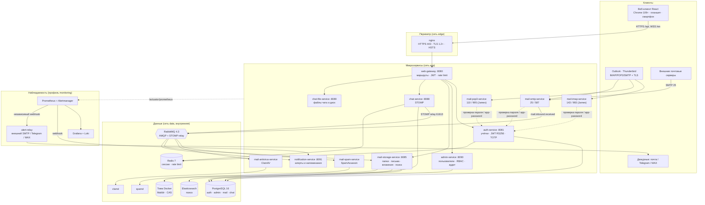
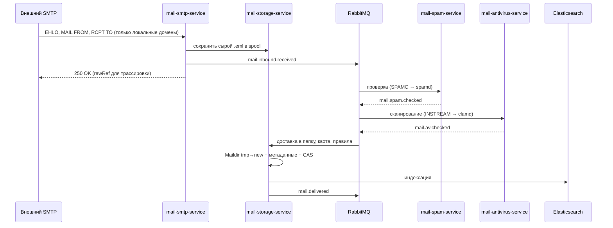

# Архитектура

Как устроен Corvex: из каких сервисов состоит, как проходит письмо, где лежат данные и
как всё это собирается в один Docker Compose. Документ описывает **замысел и текущую
реализацию**; что из этого проверено фактически — в [`STATUS.md`](STATUS.md).

## 1. Система целиком



`alert-relay` переживает отказ внутренней почты и RabbitMQ, но живёт на том же хосте:
полный отказ сервера требует внешнего watchdog.

## 2. Сервисы

| Сервис | Порт(ы) | Своя БД | Ответственность |
|---|---|---|---|
| `web-gateway` | 8080 | — | маршруты, проверка JWT, rate limit, CORS, circuit breaker |
| `auth-service` | 8081 | `auth_db` | вход, JWT/JWKS, refresh, TOTP, пароли приложений, verify-password для протоколов |
| `admin-service` | 8090 | `admin_db` | пользователи (через internal API auth), группы и права, настройки, аудит, аналитика |
| `mail-smtp-service` | 8082, 25/587 | — | приём и отправка SMTP, DKIM, очередь исходящих |
| `mail-imap-service` | 8083, 143/993 | — | IMAP поверх storage API (движок Apache James) |
| `mail-pop3-service` | 8084, 110/995 | — | POP3 поверх storage API |
| `mail-storage-service` | 8085 | `mail_db` | папки, письма, Maildir и CAS, правила, квоты, поиск, календарь |
| `mail-spam-service` | 8086 | — | SPAMC → spamd, fail-open |
| `mail-antivirus-service` | 8087 | — | INSTREAM → clamd, fail-closed |
| `chat-service` | 8088 | `chat_db` | комнаты, сообщения, реакции, STOMP, presence |
| `chat-file-service` | 8089 | ФС | файлы чата и личный диск `/api/v1/drive/**` на общем CAS |
| `notification-service` | 8091 | — | email-алерты Alertmanager, напоминания календаря |

Отдельно: `alert-relay` (Python, non-root) — внешние каналы алертов; `james` в профиле
`james-transition` — переход на James как ядро почты (см. [`MAIL.md`](MAIL.md)).

Учётные записи физически хранит `auth_db`; `admin-service` управляет ими через internal API
`auth-service`. Одна точка владения identity, никто не пишет в чужую БД.

## 3. Конвейер входящего письма

SMTP-сессия короткая, дорогая работа асинхронная. После `250 OK` письмо уже записано в
durable spool, а события лежат в надёжных очередях RabbitMQ с DLQ.



| Звено недоступно | Поведение | Почему |
|---|---|---|
| SpamAssassin | fail-open: письмо в INBOX с `X-Corvex-Spam-Checked: no` | потеря деловой почты хуже лишнего спама |
| ClamAV | fail-closed по вложению: заражённое и непроверенное не выдаётся | безопасность важнее доступности файла |
| Elasticsearch | доставка продолжается, поиск догоняет после восстановления | индекс производный, не источник истины |
| storage / RabbitMQ | SMTP отвечает `451`, а не ложным `250 OK` | отправитель повторит, письмо не потеряется |
| Повтор события | идемпотентные потребители, после 5 попыток — DLQ и алерт | AMQP даёт at-least-once |

## 4. Данные

- **Database-per-service:** `auth_db`, `admin_db`, `mail_db`, `chat_db` в одном
  PostgreSQL 16. Кросс-БД JOIN и FK запрещены; чужие идентификаторы — логические ссылки.
- **Файлы вне БД:** тела писем в Maildir, вложения в CAS по SHA-256 (физически один файл
  на всех получателей), файлы чата и диска на томах Docker.
- **Elasticsearch** — производный индекс: перестраивается из БД, в бэкап не входит.
- Все PK — UUID, время — `TIMESTAMPTZ`, размеры — `BIGINT` байт.
- Миграции — Flyway в каждом сервисе, только аддитивные (expand-contract).

| БД | Ключевые таблицы |
|---|---|
| `auth_db` | `users`, `refresh_sessions` (только SHA-256 хэши), `login_attempts` |
| `admin_db` | `user_groups`, `group_permissions`, `user_group_members`, `audit_log`, `server_settings` |
| `mail_db` | `mail_folders`, `message_metadata`, `message_recipients`, `attachments`, `message_attachments`, календарь |
| `chat_db` | `chat_rooms`, `chat_members`, `chat_messages`, `message_edit_history`, `message_reactions`, `message_mentions` |

Занятость ящика считается по `SUM(size_bytes)` метаданных плюс размер данных чата.
Квота по умолчанию — 5 ГиБ. При 90 % уходит предупреждение, при 100 % входящие получают
временный отказ, а не теряются.

## 5. Docker Compose

Один `docker-compose.yml` — источник истины. В нём **30 сервисов**, из них **20**
поднимаются без профилей: 12 Java-сервисов, frontend, nginx, PostgreSQL, Redis, RabbitMQ,
Elasticsearch, spamd, clamav. Остальные включаются профилями: `monitoring` (Prometheus,
Alertmanager, alert-relay, Grafana, Loki, Promtail) и `james-transition` / `james-provision`
(переход на James). Сетей — 5, томов — 16.

| Сеть | Кто в ней |
|---|---|
| `edge` | nginx, gateway, frontend, Grafana — единственный выход наружу, кроме почтовых портов |
| `app` | микросервисы и фильтры между собой |
| `data` (`internal`) | PostgreSQL, Redis, RabbitMQ, Elasticsearch — портов на хост нет |
| `monitoring` | Prometheus, Alertmanager, alert-relay, Grafana, Loki, Promtail |
| `james-internal` (`internal`) | James и его PostgreSQL на время перехода |

Соглашения Dockerfile одинаковы у всех 12 сервисов: сборка на `maven:3.9-eclipse-temurin-17`,
runtime на `eclipse-temurin:17-jre-alpine`, пользователь `corvex` (non-root, UID:GID
100:101), непривилегированные порты внутри контейнера, `-XX:MaxRAMPercentage=75`,
`HEALTHCHECK` по `/actuator/health` — на нём построены `depends_on: service_healthy`.

Что бэкапится: `postgres-data`, `mail-data`, `attachment-data`, `chat-file-data`,
желательно `clamav-data` и `spamd-data`. Очереди, сессии, поисковый индекс и метрики —
восстановимые, в бэкап не входят. Подробно — [`OPERATIONS.md`](OPERATIONS.md).

## 6. Frontend

React 19 + TypeScript 7 + Vite 8. Для Chrome 109 собирается отдельный legacy-бандл
(`@vitejs/plugin-legacy` → Babel 7 + core-js), актуальным браузерам отдаётся modern.
Tailwind CSS 3.4 — осознанно не 4: четвёртая версия требует возможностей, которых нет в
Chrome 109.

```
frontend/src/
├── main.tsx                 # роутер: /login, оболочка с /mail /chat /files /admin/:section (lazy)
├── app/AppShell.tsx         # единая оболочка: панель, бейджи, статус, плашка демо
├── store/sessionStore.ts    # Zustand: пользователь, права, helper has()
├── api/                     # httpClient (Bearer в памяти, refresh-cookie, авто-refresh на 401),
│                            # chatSocket (STOMP + SockJS), calendarApi, driveApi, demoData
└── features/                # auth, mail, chat, calendar, files, admin
```

- Состояние — Zustand; серверные данные в стор не копируются, каждый экран ходит в API.
- Markdown проходит единственный путь `src/lib/markdown.ts`: Marked → DOMPurify, внешние
  media и inline style запрещены, покрыто jsdom-тестами.
- HTML-письма показываются в изолированном iframe с непрозрачным origin и sandbox;
  внешние изображения не загружаются до явного разрешения.
- У каждого раздела админки есть прямой `/admin/<section>`; неизвестный или запрещённый
  заменяется первым доступным без запроса чужого API.
- Демо-режим (`?demo=1` или кнопка входа) показывает учебные данные с жёлтой плашкой и
  никогда не выдаётся за работу сервера.

## 7. Где что лежит в коде

| Вопрос | Файл |
|---|---|
| Выпуск JWT, TTL, claims | `services/auth-service/.../security/TokenService.java` |
| TOTP по RFC 6238 | `services/auth-service/.../security/TotpService.java` |
| Проверка JWT в gateway | `services/web-gateway/.../security/GatewaySecurityConfig.java` |
| Каталог 25 прав | `services/admin-service/.../rbac/Permission.java` |
| Union прав групп и 6 ролей | `services/admin-service/.../rbac/EffectivePermissionService.java` |
| Приём SMTP и anti-open-relay | `services/mail-smtp-service/.../server/InboundMessageHandlerFactory.java` |
| Maildir и CAS | `services/mail-storage-service/.../storage/MaildirStorage.java` |
| SPAMC (fail-open) | `services/mail-spam-service/.../SpamAssassinClient.java` |
| INSTREAM (fail-closed) | `services/mail-antivirus-service/.../ClamAvClient.java` |
| Порт IMAP поверх James | `services/mail-imap-service/.../server/ImapServerPort.java` |
| STOMP и RabbitMQ relay | `services/chat-service/.../config/WebSocketConfig.java` |
| Личный диск | `services/chat-file-service/.../drive/` |
| Алерты наружу | `infra/alert-relay/app.py` |

## 8. Ключевые решения

| Вопрос | Решение | Почему |
|---|---|---|
| Брокер | RabbitMQ | единицы писем в секунду на пике, нужны routing, DLQ и STOMP relay из одного брокера |
| Логи | Loki + Grafana | второй тяжёлый Elasticsearch на 16–32 ГБ не помещается рядом с поисковым |
| Почтовые протоколы | SubEtha SMTP, Apache James для IMAP/POP3 | RFC-парсеры не пишутся с нуля; порт-адаптер позволяет заменить движок |
| Хранение писем | Maildir + метаданные PostgreSQL + CAS вложений | атомарная запись, дедупликация, совместимость с инструментами миграции |
| Аутентификация | RS256 access 15 минут + вращающийся opaque refresh | локальная проверка подписи без сетевых вызовов; цена — отзыв прав до 15 минут |
| Docker на Windows Server | Linux-VM в Hyper-V | Docker Desktop официально не поддерживается на Windows Server |
| Миграции | Flyway, SQL, аддитивные | прозрачно для ревью, откат образа не требует отката схемы |
| Масштабирование | вертикальное + stateless-реплики за gateway | целевая нагрузка закрывается одним сервером; Kubernetes вне скоупа |

Проектная цель — до 1000 сотрудников; первый сервер рассчитан на ~50 ящиков. При 50
ящиках это около 2000 писем в день и пик ~1 письмо/с: конвейер проходит с запасом ×20,
узким местом становится диск и память (Elasticsearch, ClamAV), а не CPU. Расчёт под ваше
число ящиков — [`SERVER-REQUIREMENTS.md`](SERVER-REQUIREMENTS.md).
